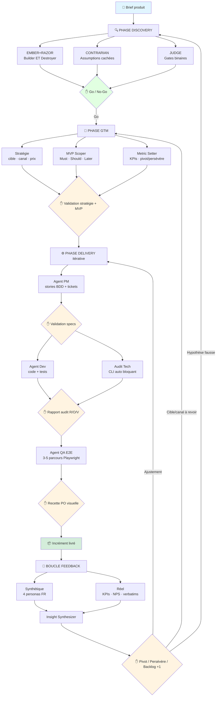
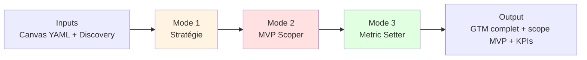
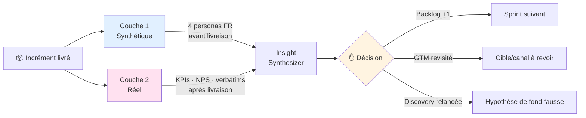
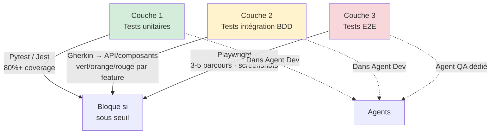
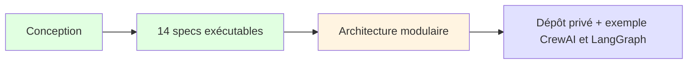

# 🤖 Solo Builder AI

> **Système d'agents IA pour produire seul des projets de qualité agence.**
> Stack : CrewAI · LangGraph · Playwright · CLI sécu (Bandit / npm audit / Lighthouse)

---

## 📌 Contexte

Je suis Scrum Master / Delivery Manager freelance avec un profil produit **pas développeur**.

Mon objectif : prendre en charge des projets de bout en bout (du challenge de l'idée jusqu'à la livraison et au feedback) sans recruter ni sous-traiter à chaque étape.

Le système d'agents IA est l'outil qui rend ça possible :

| Sans le système | Avec le système |
|---|---|
| Idée non challengée → produit qui rate sa cible | Discovery avec preuves réelles avant tout code |
| Tout livrer d'un coup → on découvre les erreurs trop tard | MVP itératif → on apprend à chaque incrément |
| Code que je ne peux pas auditer | Audit technique automatique en CLI |
| Feedback flou et tardif | Boucle 2 couches (synthétique + réel) |
| Livrables internes uniquement | 6 livrables clients event-driven, double version (Exécutif + Technique) |

Mon rôle reste où j'apporte le plus de valeur : **checkpoints de validation, arbitrages, relation client**. Le reste est délégué à des agents avec des rôles précis et des points d'arrêt explicites.

---

## 🗺️ Architecture globale

> 🟨 **Checkpoints humains** (mes points de décision)  ·  🟩 **Livraison**  ·  🟦 **Entrée brief**

---

## 🔍 Phase Discovery

> Avant de coder quoi que ce soit, le système challenge l'idée avec des preuves réelles. EMBER pitche, RAZOR tue, CONTRARIAN cherche les angles morts, JUDGE tranche.

### Agent EMBER+RAZOR : Builder ET Destroyer
Pitch l'idée sous son meilleur jour, puis la challenge immédiatement avec des preuves contraires. **Mode débat interne** dans un seul agent (économie de tokens, tension préservée).

**Sources** : Web search (Reddit · HN · G2 · Product Hunt · Crunchbase · Failory) + **Data.gouv** (INSEE, marchés sectoriels FR, données entreprises, source non biaisée, essentielle en contexte français).

**Output** : Pitch + preuves terrain + red flags + concurrents morts.

### Agent CONTRARIAN
Attaque les **assumptions cachées** : ce que je ne questionne pas car je le crois évident.

- RAZOR cherche des preuves externes (concurrents, marché)
- CONTRARIAN cherche les angles morts internes (logique du modèle, dépendances implicites, risques légaux/opérationnels)

**Exemple type** : "Ton modèle économique est-il légalement compatible avec ton statut juridique ?" : évident pour un juriste, invisible quand on est focalisé produit.

### Agent JUDGE : Gates binaires
Verdict **Go / No-Go strict**, binaire, non charmable. Inspiration : pattern Mycelium (theory gates). Chaque gate : la preuve existe ou n'existe pas. Pas de "on espère que".

**Output** : Go/No-Go + Canvas YAML v1 généré.

### ✋ Checkpoint : Go/No-Go
Je lis le rapport complet, je valide ou je demande un pivot d'orientation avant GTM.

---

## 🎯 Phase GTM

> Pourquoi GTM avant Delivery ? Pour éviter de construire le bon produit pour la mauvaise audience, via le mauvais canal, au mauvais prix. C'est aussi là que se décide le périmètre MVP.

### Agent GTM : 3 modes séquentiels (1 seul agent)

| Mode | Ce qu'il produit |
|---|---|
| **1. Stratégie** | Segment cible · canal d'acquisition · positionnement · prix · timing |
| **2. MVP Scoper** | **Must** (sprint 1) · **Should** (sprint 2-3) · **Later** (après validation) |
| **3. Metric Setter** | KPIs par incrément · critères de **pivot** · critères de **persévère**, définis **avant** livraison |

> 💡 Les critères pivot/persévère sont définis **avant** de livrer, pas après. Ça évite le biais de confirmation ("on garde parce qu'on a construit"). Les métriques tranchent objectivement.

### ✋ Checkpoint : Validation stratégie + scope MVP
Dernier checkpoint avant que l'Agent PM commence à générer des stories.

---

## ⚙️ Phase Delivery itérative

> On ne livre pas "le produit". On livre des **incréments utiles** en cycle court. Le premier = MVP. Chaque sprint suivant piloté par ce qu'on a appris.

### Agent PM
**Input** : Canvas YAML + scope MVP. **Output** : Backlog priorisé · user stories au format **BDD/Gherkin** · critères d'acceptance.

> 💡 BDD = pont entre le PM/PO et le dev. Les scénarios *Étant donné / Quand / Alors* sont en langage naturel : je les valide sans lire du code. Ces mêmes scénarios deviennent les tests d'intégration de l'Agent Dev. Un document source, deux usages.

### ✋ Checkpoint : Validation specs + priorisation
Mon checkpoint le plus important en Delivery. Je valide les stories, je vérifie que le Must est bien le MVP, j'ajuste les priorités.

### Agent Dev
Produit le code, l'architecture, le schéma de base de données.
**Règle clé** : il génère **ses propres** tests unitaires et d'intégration en même temps qu'il code. Pas d'agent QA séparé pour ça.

### Agent Audit Tech : 100% automatique
**Outils CLI** (quasi zéro tokens LLM) :

| Outil | Vérifie |
|---|---|
| **Bandit** | Sécurité Python |
| **npm audit** | Vulnérabilités dépendances JS |
| **Lighthouse** | Performance + accessibilité web |

**Règle de blocage** :
- 🔴 **Rouge** → livraison bloquée automatiquement par LangGraph
- 🟠 **Orange** → remonte à moi pour décision
- 🟢 **Vert** → pipeline continue

### ✋ Checkpoint : Rapport audit
Je lis le rapport (feux R/O/V). Les rouges sont déjà bloqués. Je décide sur les oranges.

### Agent QA E2E : Playwright
**Règle absolue** : 3-5 parcours critiques **maximum**. Login/auth · parcours principal · 2-3 cas limites critiques.
**Output** : Screenshots + vidéos de chaque parcours.

> 💡 La règle 3-5 est non-négociable. (1) Coût : un E2E complet = 20-50k tokens et 5-15 min par run. (2) Fragilité : casse dès qu'un élément UI change de place. On couvre ce qui ne change pas souvent et représente la valeur core.

### ✋ Checkpoint : Recette finale PO
Je regarde screenshots et vidéos. Je valide. **Zéro code à lire** : c'est le principe.

---

## 🔁 Boucle de feedback : 2 couches

### Couche 1 : Synthétique (avant livraison)
4 agents personas ancrés contexte IT/PME français :

| Persona | Profil | Ce qu'il challenge | Signal d'alerte |
|---|---|---|---|
| **DSI PME prudent** | Budget serré, allergique à la complexité | Maintenabilité, TCO, dépendance fournisseur | Solution trop complexe à maintenir seul |
| **Dirigeant non-tech** | Voit la valeur métier, pas les choix techniques | Clarté valeur, ROI visible, timeline | Livrable illisible sans explication |
| **Dev senior sceptique** | Challenge tout, déteste le sur-engineering | Qualité code, dette technique, scalabilité | Choix techniques non justifiés |
| **Utilisateur final pressé** | Adopte si intuitif en 2 min, abandonne sinon | UX, onboarding, friction parcours | Parcours principal > 3 étapes |

### Couche 2 : Réel (après livraison)
KPIs définis par le Metric Setter : **activation** (% qui complètent le parcours principal) · **rétention** (J+7) · **time-to-value** · NPS / verbatims qualitatifs.

### Agent Insight Synthesizer
Croise synth + réel. **Prioritise ce qui est confirmé par les deux sources**. Propose le niveau de remontée.

### ✋ Checkpoint : Décision pivot/persévère
- **Backlog sprint +1** : ajustement mineur, on continue
- **GTM revisité** : la cible ou le canal est à revoir
- **Discovery relancée** : une hypothèse de fond était fausse

> 🎯 **Règle d'or** : Synthétique = vitesse + détection précoce. Réel = vérité + décision. Les deux ensemble = cycle court **et** fiable.

---

## 📄 Agent Livrable : 6 livrables event-driven

> L'Agent PM gère les specs internes. L'Agent Livrable gère les documents clients : audience différente, langage différent, format différent.

### Principe : double version systématique
Chaque livrable existe en deux formats depuis la même source (Canvas YAML) :
- **Version Exécutif** : 1 page, langage métier, lisible sans contexte technique
- **Version Technique** : détaillée, jargon IT, pour DSI et équipes dev

### Déclenchement event-driven
L'agent écoute les événements système et se déclenche uniquement quand un livrable est impacté.

| Livrable | Déclencheur | Fréquence MAJ |
|---|---|---|
| **Impact Map** | Fin Discovery validée | Si scope change |
| **Story Map** | Après Agent PM | Chaque sprint |
| **Roadmap Now/Next/Later** | Validation GTM | Chaque sprint |
| **Sprint Review Deck** | Fin chaque incrément | Chaque sprint |
| **Rapport Audit Tech** (2 versions) | Après Audit Tech | Chaque incrément |
| **Decision Log** | Toute décision système | Continu |

**Formats** : **Notion** (principal, partageable par lien, MCP déjà actif) · **HTML statique** (visuels complexes, convertissable PDF).

> 💡 Le **Decision Log** est un différenciateur commercial fort. Trace horodatée de toutes les décisions (pourquoi ce scope, pourquoi ce choix technique, pourquoi ce pivot). En contexte réglementaire ou projet complexe, personne ne le produit spontanément.

---

## 🧪 QA : Architecture 3 couches

| Couche | Coût tokens | Vitesse |
|---|---|---|
| Unitaires (dans Dev) | Quasi nul | Très rapide |
| Intégration BDD (dans Dev) | Moyen | Moyenne |
| E2E (Agent QA dédié) | Élevé | Lente : limité aux parcours critiques |

> 💡 80/20 appliqué à la QA. 3 niveaux de risque à des coûts très différents.

---

## 🧠 Canvas YAML : Mémoire centrale

Fichier unique versionné dans GitHub. Contient **tout** : contexte projet, décisions, outputs de chaque phase, profil destinataires livrables, métriques de succès.

**Règle de gouvernance** :
- ✅ **Un seul écrivain** : LangGraph Orchestrateur
- ✅ Les agents **soumettent** leurs outputs à l'Orchestrateur
- ✅ L'Orchestrateur **valide et écrit** dans le Canvas
- ❌ **Zéro conflit** d'écriture possible

Tous les agents **lisent** le Canvas en début de run pour avoir le contexte complet.
L'Agent Livrable s'en sert comme source unique pour générer tous les documents clients.

---

## 🛠️ Stack technique

| Composant | Usage | Coût |
|---|---|---|
| **Claude Max** | Moteur principal : Discovery, challenge, specs, livrables | ~90€/mois |
| **CrewAI** | Framework rôles agents | Gratuit (open source) |
| **LangGraph** | Orchestration + checkpoints human-in-loop | Gratuit (open source) |
| **Playwright** | Tests E2E browser automation | Gratuit (open source) |
| **GitHub** | Versionning prompts + Canvas YAML | Gratuit |
| **Data.gouv** | Données officielles françaises en Discovery | Gratuit (API) |
| **Bandit / npm audit / Lighthouse** | Audit CLI sécu & perf | Gratuit |
| **Notion** | Livrables clients (via MCP) | Inclus abonnement existant |

### Répartition moteurs
| Tâche | Moteur | Coût tokens |
|---|---|---|
| Discovery, challenge, specs, livrables | Claude Max | Inclus abonnement |
| Reformatage, extraction, variations simples | Ollama (Mac Mini M2 local) | 0€ après hardware |
| Orchestration pipelines | Railway / Render | ~10€/mois |
| Automatisations métier | Make | ~10€/mois |

**Budget cible** : **110–120€/mois** (Claude Max 90€ + cloud/Make 20-30€). Mac Mini M2 d'occasion ~500-600€, ROI en 4-5 mois vs API équivalente.

---

## 🤖 Récapitulatif des agents

| # | Agent | Phase | Rôle en une ligne |
|---|---|---|---|
| 1 | **EMBER+RAZOR** | Discovery | Builder ET Destroyer : débat interne avec preuves réelles |
| 2 | **CONTRARIAN** | Discovery | Attaque les assumptions cachées |
| 3 | **JUDGE** | Discovery | Go/No-Go binaire : bloque sans preuves |
| 4 | **Agent GTM** | GTM | Stratégie + MVP Scoper + Metric Setter (3 modes) |
| 5 | **Agent PM** | Delivery | Stories BDD + tickets priorisés |
| 6 | **Agent Dev** | Delivery | Code + archi + tests unit/intégration |
| 7 | **Agent Audit Tech** | Delivery | Sécu + perf CLI · 100% auto · bloquant si rouge |
| 8 | **Agent QA E2E** | Delivery | Playwright 3-5 parcours · screenshots + vidéos |
| 9 | **Insight Synthesizer** | Feedback | Croise synth + réel → insights actionnables |
| 10 | **Agent Livrable** | Transverse | 6 livrables clients event-driven · Notion + HTML |

> **8 agents actifs en régime de croisière.** Agent Dev absorbe QA unit/intégration. Agent GTM fusionne 3 rôles. Objectif : éviter la prolifération qui complexifie la maintenance.

---

## 📐 Règles d'or

| Règle | Pourquoi |
|---|---|
| 1 agent = 1 rôle, 1 responsabilité | Un agent surchargé fait deux choses à moitié |
| Canvas YAML = seule source de vérité | Tous lisent/écrivent via LangGraph Orchestrateur uniquement |
| Checkpoint humain avant chaque phase critique | Discovery → GTM → Specs → Livraison → Feedback |
| E2E Playwright = 3-5 parcours critiques max | E2E exhaustif = fragile et coûteux. 20% scénarios = 80% bugs réels |
| Claude Max pour le complexe, Ollama pour le répétitif | Gestion raisonnée coût/gain tokens |
| Livrables double version systématique | Exécutif (métier) + Technique (IT) depuis le même Canvas |
| Anonymiser avant d'injecter | Données sensibles ne transitent pas telles quelles |
| MVP du système avant système complet | Valider 4 agents core avant d'en ajouter |
| Feedback synthétique + réel ensemble | Synthétique = vitesse. Réel = vérité. Les deux = fiabilité |

---

## 🔒 Sécurité des données

| Niveau | Approche |
|---|---|
| **Démarrage / PME / projets internes** | Anonymiser les briefs avant injection (`CLIENT_A`, données financières arrondies), suffisant pour 95% des cas |
| **Grand compte / RGPD strict** | Claude for Enterprise ou anonymisation systématique renforcée |
| ❌ **À ne jamais injecter** | Données personnelles identifiables · secrets industriels non anonymisés · mots de passe · clés API |

---

## 🌙 Mode autopilote

Le système peut avancer **sans moi devant l'écran**. Une session Claude Code dans le cloud travaille seule, souvent la nuit, sous un compte GitHub dédié, et dépose son travail sous forme de demandes de fusion. Les garde-fous :

- **Rien n'arrive sur `main` sans mon approbation** : c'est GitHub qui bloque, pas la discipline de l'agent.
- **Rien n'est mis en ligne**, aucun message n'est envoyé, rien n'est supprimé.
- **Données de test seulement.**
- **Un comité qui construit et un comité qui conteste**, séparés, et un feu 🟢 🟠 🔴 par fonctionnalité. La sécurité, l'argent, les suppressions et les messages sont toujours 🔴 : ils attendent ma décision.
- **Un bilan écrit au réveil** : je relis et je décide de ce qui est fusionné.

Les consignes de l'agent sont dans [`AUTOPILOTE.md`](AUTOPILOTE.md). Premier run, dans la nuit du 23 au 24/11/2026 : 13 demandes de fusion, aucune alerte rouge, et deux brouillons qui assouplissaient une règle de sécurité ont été corrigés par le relecteur avant de m'arriver.

---

## 🚀 Statut & prochaine étape

**Conception** : ✅ Terminée
**Specs des agents** : ✅ 14 specs exécutables dans [`agents/`](agents/), dont 12 rédigées en une nuit par le mode autopilote (24/11/2026), puis relues et validées
**Architecture** : ✅ un socle commun, des briques réutilisables, des chaînes qui les enchaînent (voir [`docs/ARCHITECTURE.md`](docs/ARCHITECTURE.md))
**Prochaine étape** : le dépôt privé du système qui tourne, puis un exemple exécutable avec CrewAI et LangGraph

---

## 📚 Historique des versions

<strong>V1 : Système initial</strong> (référence historique)

> Pipeline linéaire Discovery → Delivery. Pas de GTM, pas de MVP, pas de boucle feedback. Sert de référence pour comprendre l'évolution vers la V2.

**Ce que V1 faisait bien** :
- Challenge solide de l'idée avant de construire (EMBER, RAZOR, CONTRARIAN, JUDGE)
- Pipeline Delivery structuré avec points d'intervention humaine clairs
- Séparation nette des responsabilités entre agents

**Ce qui manquait (résolu en V2)** :
1. **Pas de GTM** : on validait l'idée mais pas comment la lancer
2. **Pas de MVP** : on livrait "le produit" entier, pas un incrément utile
3. **Pipeline linéaire** : pas de boucle, pas d'apprentissage post-livraison
4. **Pas de livrables clients** : code et specs internes uniquement
5. **Pas de feedback loop** : une fois livré, le système s'arrêtait

**Différences clés V1 → V2** :
- EMBER et RAZOR séparés → fusionnés en **EMBER+RAZOR** (débat interne, économie de tokens)
- Ajout de la **phase GTM** complète entre Discovery et Delivery
- Delivery linéaire → **itératif et incrémental**
- Ajout de la **boucle de feedback 2 couches** + Insight Synthesizer
- Ajout de l'**Agent Livrable** (6 livrables event-driven, double version)

---

## 🔄 Évolutions

Ce document est mis à jour à mesure que le système évolue. Les versions majeures (V1, V2, V3...) sont conservées en historique pour garder la trace des décisions et de leur motivation.
