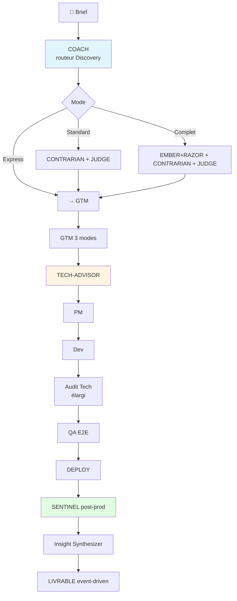

# 🤖 Agents — Index

> **Statut** : V3 du système. 12 agents identifiés (8 actifs en régime de croisière + 4 conditionnels).

---

## 🗺️ Vue d'ensemble

---

## 📋 Liste des agents

| # | Agent | Phase | Statut spec | Mode | Skippable |
|---|---|---|---|---|---|
| 1 | [COACH](coach.md) | Discovery | ✅ Spec exécutable | perso + client | jamais |
| 2 | [EMBER+RAZOR](ember-razor.md) | Discovery | 🕐 À spec | perso + client | ✅ Express |
| 3 | [CONTRARIAN](contrarian.md) | Discovery | 🕐 À spec | perso + client | ✅ Express |
| 4 | [JUDGE](judge.md) | Discovery | 🕐 À spec | perso + client | ✅ Express |
| 5 | [GTM](gtm.md) | GTM | 🕐 À spec | perso + client | ✅ si outil one-shot |
| 6 | [TECH-ADVISOR](tech-advisor.md) | Transverse | ✅ Spec exécutable | perso + client | ✅ si stack imposée |
| 7 | [PM](pm.md) | Delivery | 🕐 À spec | perso + client | ❌ sauf no-code pur |
| 8 | [Dev](dev.md) | Delivery | 🕐 À spec | perso + client | ❌ sauf no-code pur |
| 9 | [Audit Tech](audit-tech.md) | Delivery | 🕐 À spec | perso + client | jamais |
| 10 | [QA E2E](qa-e2e.md) | Delivery | 🕐 À spec | perso + client | ✅ si pas d'UI |
| 11 | [DEPLOY](deploy.md) | Delivery | 🕐 À spec | perso + client | ✅ si pas de déploiement |
| 12 | [SENTINEL](sentinel.md) | Feedback | 🕐 À spec | perso + client | ❌ en prod |
| 13 | [Insight Synthesizer](insight-synthesizer.md) | Feedback | 🕐 À spec | perso + client | ✅ si pas d'utilisateurs |
| 14 | [Livrable](livrable.md) | Transverse | 🕐 À spec | client surtout | ✅ off par défaut en perso |

---

## 🎯 Ordre de spécification (priorisé MVP système)

Cf [`policies/perso-profile.md`](../policies/perso-profile.md) — les 4 agents prioritaires pour livrer un MVP système fonctionnel rapidement :

1. **COACH** — routeur Discovery, point d'entrée du système
2. **TECH-ADVISOR** — clarté sur la stack avant Delivery
3. **CONTRARIAN + JUDGE** — minimum viable pour mode Standard
4. **PM** — pour démarrer Delivery même sans Dev

Les autres viennent après, ordre indicatif :
**EMBER+RAZOR → GTM → Audit Tech élargi → QA E2E → DEPLOY → SENTINEL → Insight Synthesizer → Livrable → Dev**

---

## 📐 Template à utiliser

Tous les agents respectent [`_TEMPLATE.md`](_TEMPLATE.md) — 14 sections obligatoires, prompt versioning inline, golden cases avec critères Python testables, section Sécurité par agent.

## 🟡 Cadrages légers des 12 agents restants

Vue d'ensemble pour la cohérence du système : [`light-specs.md`](light-specs.md). Les prompts v1.0 et les golden cases Python testables seront rédigés agent par agent au passage en spec exécutable.

---

## 🔐 Agents critiques (tests adversariaux obligatoires)

Ces agents prennent des décisions structurantes — tests adversariaux non négociables :

- **COACH** (point d'entrée — injection probable dès le brief)
- **EMBER+RAZOR** (web search — sources externes hostiles potentielles)
- **CONTRARIAN** (pourrait être manipulé pour "rester positif")
- **JUDGE** (verdict Go/No-Go — cible naturelle)
- **Audit Tech** (peut être contourné par commentaires dans le code)
- **Insight Synthesizer** (croise feedback — manipulation des KPIs possible)
