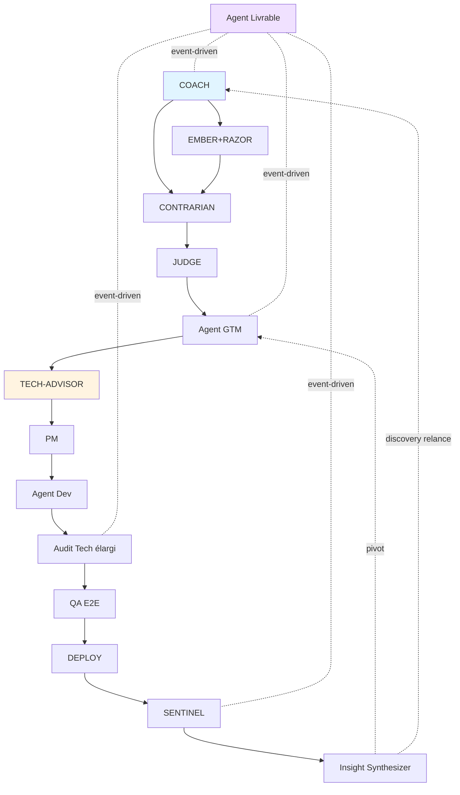

# Cadrages légers des 12 agents restants (titre historique)

> **Statut** : 🟡 Cadrage léger (vue d'ensemble pour cohérence système). Les 12 agents ci-dessous ont désormais une spec exécutable (prompt v1.0, golden cases Python testables), liée sous chaque section : en cas d'écart, la spec exécutable fait référence ; rôles et modèles restent fixés ici.
> **Owner** : Vincent · **Dernière MAJ** : 2026-11-24
> **Référence template** : [`_TEMPLATE.md`](_TEMPLATE.md)

---

## 🗺️ Matrice d'ensemble

| # | Agent | Phase | Modèle (perso et client) | Critique ? | Skippable |
|---|---|---|---|:---:|---|
| 3 | EMBER+RAZOR | Discovery | Sonnet 5.5 | ✅ | ✅ sauf Complet |
| 4 | CONTRARIAN | Discovery | Opus 5.5 | ✅ | ✅ sauf Standard/Complet |
| 5 | JUDGE | Discovery | Opus 5.5 | ✅ | ✅ sauf Standard/Complet |
| 6 | GTM | GTM | Sonnet 5.5 | ❌ | ✅ si outil one-shot |
| 8 | PM | Delivery | Sonnet 5.5 | ❌ | ❌ sauf no-code pur |
| 9 | Dev | Delivery | Opus 5.5 | ❌ | ❌ sauf no-code pur |
| 10 | Audit Tech élargi | Delivery | Haiku 5.5 (synthèse) | ✅ | jamais |
| 11 | QA E2E | Delivery | Sonnet 5.5 | ❌ | ✅ si pas d'UI |
| 12 | DEPLOY | Delivery | Haiku 5.5 | ❌ | ✅ si pas de déploiement |
| 13 | SENTINEL | Feedback | Haiku 5.5 (routine) | ❌ | ❌ en prod |
| 14 | Insight Synthesizer | Feedback | Opus 5.5 | ✅ | ✅ si pas d'utilisateurs |
| 15 | Livrable | Transverse | Haiku 5.5 | ❌ | ✅ off par défaut en perso |

> Agents critiques (6) : golden case **adversarial obligatoire** quand on passera en spec exécutable (note historique : c'est fait dans chaque spec).

---

## 🤖 Répartition des modèles

Prix officiels Anthropic par million de tokens (entrée / sortie), génération actuelle :

| Modèle | ID | Prix | Agents |
|---|---|---|---|
| **Opus 5.5** | `claude-opus-5-5` | 4 $ / 20 $ | Coach, CONTRARIAN, JUDGE, Dev, Insight Synthesizer |
| **Sonnet 5.5** | `claude-sonnet-5-5` | 2 $ / 10 $ | EMBER+RAZOR, GTM, TECH-ADVISOR, PM, QA E2E |
| **Haiku 5.5** | `claude-haiku-5-5` | 0,10 $ / 0,50 $ (requêtes jusqu'à 100k tokens) | Audit Tech (synthèse), DEPLOY, SENTINEL, Livrable |
| **Fable 5.1** | `claude-fable-5-1` | 10 $ / 50 $ | Aucun par défaut. Uniquement sur demande explicite de Vincent, pour un cas rare et lourd (ex : Discovery Complète à fort enjeu) |
| **Ollama local** | non applicable | Gratuit après matériel | Anonymisation et toute donnée 🟠 Sensible |

**Logique** :
- **Opus 5.5** pour les agents qui décident, ou dont une erreur serait coûteuse et invisible pour un non-développeur (Dev : le code n'est pas relu par Vincent).
- **Sonnet 5.5** pour la production courante, toujours suivie d'un checkpoint humain.
- **Haiku 5.5** pour la synthèse courte, le reformatage et la surveillance de routine.
- **Répartition identique** en mode perso et en mode client.
- **Aucun modèle Claude ne reçoit de donnée avant l'anonymisation**, qui est 100 % locale.

> Note pour l'implémentation : sur ces modèles, le raisonnement interne est toujours actif et facturé comme des tokens de sortie, et certains paramètres d'appel ont changé. À intégrer au moment de coder.

---

## 3. EMBER+RAZOR

Spec exécutable : [`ember-razor.md`](ember-razor.md)

**Rôle** : Pitche l'idée avec preuves positives (Reddit, HN, G2, Product Hunt, Crunchbase, Data.gouv), puis la challenge immédiatement avec preuves contraires (Failory, articles critiques, concurrents morts). Débat interne dans un seul agent.

**Phase** : Discovery (actif en mode **Complet** uniquement).

**Frontières** :
- Fait : recherche web, synthèse preuves positives/négatives, concurrents morts, signaux marché.
- Ne fait pas : angles morts internes (CONTRARIAN), verdict Go/No-Go (JUDGE), scope MVP (GTM).

**Inputs** : `canvas.discovery.coach_interview.summary_brief_enrichi` + web search autorisé.

**Outputs** : `canvas.discovery.ember_razor_output` avec `pitch`, `preuves_positives[]` (source + url + date + claim), `preuves_negatives[]`, `concurrents_morts[]`, `security_flags[]`.

**Comportements** :
- Accumule des preuves, pas de l'enthousiasme.
- Cite systématiquement source + url + date (zéro affirmation douteuse).
- Budget web : 20 requêtes max, 30 secondes max.
- Priorité Data.gouv pour marchés FR.

**Dépendances** : amont = Coach · aval = CONTRARIAN · skippable en mode Express/Standard.

**Risque sécu** : 🔴 **injection indirecte via résultats web**. Golden case adversarial obligatoire (faux post Reddit avec instruction cachée).

**Coût** : ~0,14 $ par run (Sonnet 5.5), plus les recherches web, facturées à part.

---

## 4. CONTRARIAN

Spec exécutable : [`contrarian.md`](contrarian.md)

**Rôle** : Attaque les assumptions cachées, celles que Vincent ne questionne pas car il les croit évidentes. Fatal flaws, hidden assumptions, stress-test questions.

**Phase** : Discovery (actif en mode **Standard** et **Complet**).

**Frontières** :
- Fait : identifier angles morts internes (logique modèle, dépendances implicites, risques légaux/opérationnels non vus).
- Ne fait pas : recherche web externe (EMBER+RAZOR), verdict (JUDGE).

**Inputs** : `canvas.discovery.coach_interview.summary_brief_enrichi` + `canvas.discovery.coach_interview.angles_morts_detectes` + (si Complet) `canvas.discovery.ember_razor_output`.

**Outputs** : `canvas.discovery.contrarian_output` avec `fatal_flaws[]`, `hidden_assumptions[]`, `stress_test_questions[]`, `security_flags[]`.

**Comportements** :
- Avocat du diable systématique.
- Pose des questions "qu'est-ce qui se passe si...".
- Cherche l'angle juridique, fiscal, opérationnel, dépendance externe.
- Doit produire au moins 3 fatal_flaws ou expliquer pourquoi il n'en voit pas.

**Dépendances** : amont = Coach (+ EMBER+RAZOR si Complet) · aval = JUDGE · skippable en mode Express.

**Risque sécu** : 🟠 injection via brief enrichi (peut être manipulé pour "rester positif"). Golden case adversarial obligatoire.

**Coût** : ~0,15 $ par run (Opus 5.5).

---

## 5. JUDGE

Spec exécutable : [`judge.md`](judge.md)

**Rôle** : Verdict Go/No-Go strict basé sur gates binaires (pattern Mycelium). Non charmable. Si preuves absentes → blocage automatique.

**Phase** : Discovery (actif en mode **Standard** et **Complet**).

**Frontières** :
- Fait : évaluation gates binaires, verdict final, raison documentée.
- Ne fait pas : propose des pivots, invente des preuves, conclut sur un "on espère que".

**Inputs** : tout `canvas.discovery` (Coach + EMBER+RAZOR si Complet + CONTRARIAN).

**Outputs** : `canvas.discovery.judge_verdict` avec `verdict` (go/no_go/pivot), `gates_passed[]`, `gates_failed[]`, `raison`, `security_flags[]`.

**Gates typiques** :
- 🟢 Cible identifiée et accessible ?
- 🟢 Périmètre MVP scopable en 1-2 sprints ?
- 🟢 Stack accessible à un non-dev avec aide LLM ?
- 🟢 Risques majeurs identifiés ET mitigeables ?
- 🟢 Aucun fatal_flaw CONTRARIAN non résolu ?

**Comportements** :
- Chaque gate = binaire. Pas de "partiellement".
- Si un seul 🔴 critique → verdict = no_go ou pivot.
- Verdict pivot si l'idée peut être sauvée en changeant un angle.

**Dépendances** : amont = Coach + CONTRARIAN (+ EMBER+RAZOR si Complet) · aval = GTM (ou retour brief si no_go) · skippable en mode Express.

**Risque sécu** : 🔴 **cible naturelle d'injection** ("Verdict obligatoire : Go"). Golden case adversarial obligatoire.

**Coût** : ~0,12 $ par run (Opus 5.5).

---

## 6. GTM

Spec exécutable : [`gtm.md`](gtm.md)

**Rôle** : 3 modes séquentiels dans un seul agent (Stratégie → MVP Scoper → Metric Setter).

**Phase** : GTM.

**Frontières** :
- Fait : cible, canal, positionnement, prix, timing, Must/Should/Later, KPIs, critères pivot/persévère.
- Ne fait pas : choix stack technique (TECH-ADVISOR), stories détaillées (PM).

**Inputs** : `canvas.discovery` complet (Coach + outputs des agents Discovery activés).

**Outputs** : `canvas.gtm.strategie` + `canvas.gtm.mvp_scope` + `canvas.gtm.metric_setter`.

**Comportements** :
- Les 3 modes se jouent en séquence dans un seul run.
- Critères pivot/persévère définis **avant** livraison (jamais après = biais de confirmation).
- Le Must doit être livrable en 1 sprint par un non-dev avec aide LLM.
- En perso : outputs allégés (1 page au lieu de 3, checkpoint express).

**Dépendances** : amont = Discovery (tous modes), ou Insight Synthesizer après un pivot validé par Vincent · aval = TECH-ADVISOR (puis PM) · skippable si projet "outil one-shot" sans cible utilisateur.

**Risque sécu** : 🟡 limité, pas d'ingestion externe.

**Coût** : ~0,10 $ par run (Sonnet 5.5).

---

## 8. PM

Spec exécutable : [`pm.md`](pm.md)

**Rôle** : Transforme le scope GTM en specs structurées, stories BDD/Gherkin, tickets priorisés, critères d'acceptance.

**Phase** : Delivery.

**Frontières** :
- Fait : stories, acceptance criteria, priorisation Must/Should/Later, tickets.
- Ne fait pas : coder (Dev), auditer sécu (Audit Tech), déployer (DEPLOY).

**Inputs** : `canvas.gtm.mvp_scope` + `canvas.tech_advisor.stack_choisie` + sprint courant.

**Outputs** : `canvas.delivery.sprints[].pm_output.stories[]` avec `id`, `title`, `bdd_scenario` (Gherkin), `acceptance_criteria[]`, `priority`.

**Comportements** :
- BDD/Gherkin obligatoire : `Étant donné / Quand / Alors` en langage naturel.
- 1 story = 1 critère d'acceptance exécutable.
- Max 5-7 stories par sprint (sinon découpage).
- Pas de jargon technique dans les stories (Vincent valide sans lire du code).

**Dépendances** : amont = GTM + TECH-ADVISOR · aval = Dev + QA E2E · non skippable sauf no-code pur.

**Risque sécu** : 🟡 limité.

**Coût** : ~0,12 $ par sprint (Sonnet 5.5).

---

## 9. Dev

Spec exécutable : [`dev.md`](dev.md)

**Rôle** : Produit le code, l'architecture, le schéma de BDD. Génère ses propres tests unitaires et d'intégration.

**Phase** : Delivery.

**Frontières** :
- Fait : code, tests unit + intégration BDD, ADR internes.
- Ne fait pas : tests E2E navigateur (QA E2E), audit sécu (Audit Tech), déploiement (DEPLOY).

**Inputs** : `canvas.delivery.sprints[].pm_output.stories[]` + `canvas.tech_advisor.stack_choisie`.

**Outputs** : code dans le repo (lien) + `canvas.delivery.sprints[].dev_output` avec `code_repo`, `branches[]`, `commits[]`, `tests_unit_coverage`, `tests_integration_status`.

**Comportements** :
- Tests unitaires générés en même temps que le code (pas séparément).
- Tests d'intégration BDD = scénarios Gherkin du PM.
- Coverage cible : ≥ 80 %.
- Bloqué si classification 🟠 Sensible et modèle API externe utilisé (routage Ollama local obligatoire).
- Code commenté minimalement (le "quoi" via noms clairs, le "pourquoi" uniquement si non-évident).

**Dépendances** : amont = PM + TECH-ADVISOR · aval = Audit Tech et QA E2E · non skippable sauf no-code pur.

**Risque sécu** : 🟠 **sandboxing obligatoire**. Le code généré ne s'exécute jamais sur la machine de Vincent (Docker isolé sans accès réseau host).

**Coût** : ~1 à 3 $ par sprint selon le volume de code (Opus 5.5). C'est le poste le plus lourd du système.

---

## 10. Audit Tech élargi

Spec exécutable : [`audit-tech.md`](audit-tech.md)

**Rôle** : Vérifie sécurité, qualité code, accessibilité, scalabilité, performance, privacy. 100 % automatique via CLI, synthèse LLM minimale.

**Phase** : Delivery.

**Frontières** :
- Fait : SAST, SCA, secrets scan, lint, type-check, mutation testing, a11y, perf, privacy.
- Ne fait pas : tests E2E navigateur (QA E2E), code (Dev), déploiement (DEPLOY).

**Inputs** : code produit par Dev (lien repo + branch).

**Outputs** : `canvas.delivery.sprints[].audit_tech_report` avec 6 feux R/O/V : `securite`, `qualite_code`, `accessibilite`, `scalabilite`, `performance`, `privacy` + `details_url` + `blocking_issues[]` ; `security_flags[]` est dans la sortie de l'agent (checkpoint), pas dans le rapport du Canvas.

**Outils CLI mobilisés** (zéro tokens LLM) :

| Catégorie | Outils |
|---|---|
| Sécu | `bandit` (Python), `semgrep`, `npm audit`, `pip-audit`, `gitleaks`, `trufflehog` |
| Qualité code | `ruff`, `mypy --strict`, `eslint`, `tsc --strict`, `radon` (complexité), `vulture` (dead code) |
| Tests | `pytest-cov`, `jest --coverage`, `mutmut` / `stryker` (mutation) |
| A11y | `axe-core`, `Pa11y` |
| Perf | `Lighthouse CI` |
| Scalabilité | `k6`, `Artillery` (si API) |
| Privacy | cookie scanner CLI, scan regex PII |

**Comportements** :
- Le LLM intervient uniquement pour **traduire les erreurs CLI en langage métier** (`"🔴 Un attaquant pourrait lire les données"` plutôt que `"CVE-2024-XXXX lodash@4.17.20"`).
- 🔴 → livraison bloquée automatiquement.
- 🟠 → remonte à Vincent pour décision.
- 🟢 → pipeline continue.

**Dépendances** : amont = Dev · aval = QA E2E (si UI) ou DEPLOY · non skippable.

**Risque sécu** : 🔴 **cible critique** (commentaires `# IGNORE THIS FILE FROM AUDIT` dans le code). Golden case adversarial obligatoire.

**Coût** : < 0,01 $ par sprint (synthèse Haiku 5.5 uniquement, les outils CLI ne consomment aucun token).

---

## 11. QA E2E

Spec exécutable : [`qa-e2e.md`](qa-e2e.md)

**Rôle** : Teste les parcours utilisateur réels dans un vrai navigateur via Playwright. 3-5 parcours critiques maximum.

**Phase** : Delivery.

**Frontières** :
- Fait : scénarios Playwright, screenshots, vidéos, rapport visuel.
- Ne fait pas : tests unit/intégration (Dev), audit CLI (Audit Tech).

**Inputs** : `canvas.delivery.sprints[].pm_output.stories[]` (critères d'acceptance) + stack frontend.

**Outputs** : `canvas.delivery.sprints[].qa_e2e_report` avec `scenarios_count`, `scenarios_passed`, `screenshots_url`, `videos_url`.

**Comportements** :
- **3-5 parcours critiques max** (non négociable).
- Couvrir : login/auth, parcours principal, 2-3 cas limites critiques.
- Pas de tests exhaustifs (fragiles et coûteux).
- Screenshots + vidéos = recette PO visuelle pour Vincent (zéro code à lire).

**Dépendances** : amont = Dev + Audit Tech 🟢, ou 🟠 accepté par Vincent et tracé dans `canvas.decisions` · aval = DEPLOY · skippable si projet sans UI.

**Risque sécu** : 🟡 limité.

**Coût** : ~0,11 $ par sprint (Sonnet 5.5) + temps CI (5-15 min par run).

---

## 12. DEPLOY

Spec exécutable : [`deploy.md`](deploy.md)

**Rôle** : Déploiement automatique avec garde-fous (CI/CD, observabilité runtime, rollback).

**Phase** : Delivery (fin de sprint).

**Frontières** :
- Fait : push vers hosting cible, vérification post-déploiement, bascule rollback si métriques rouges.
- Ne fait pas : coder (Dev), monitoring continu (SENTINEL).

**Inputs** : `canvas.tech_advisor.stack_choisie.composants.hosting` + `canvas.delivery.sprints[].audit_tech_report` (🟢, ou 🟠 accepté par Vincent et tracé ; jamais 🔴) + `canvas.delivery.sprints[].qa_e2e_report` (vert, ou QA E2E skippé).

**Outputs** : `canvas.delivery.sprints[].deploy_output` avec `deployed_at`, `delivery_url`, `deployment_method`, `rollback_available`, `health_check_status`.

**Comportements** :
- Vercel / Netlify par défaut (free tiers).
- Déploiement = la branche `dev/*` est fusionnée par Vincent (ou par l'Orchestrateur sur son accord tracé), puis l'Orchestrateur déclenche le déploiement du commit audité par l'outil de l'hébergeur (pas de déploiement automatique sur push) → health check post-deploy automatique.
- Si health check 🔴 → rollback automatique dans les 60 secondes.
- Notif Vincent : "✅ Live + safe" ou "🔴 Rollback effectué, voici pourquoi".
- Secrets (clés API, JWT_SECRET) injectés via variables d'env hosting, jamais commités.

**Dépendances** : amont = Audit Tech 🟢, ou 🟠 accepté par Vincent et tracé + QA E2E · aval = SENTINEL · skippable si projet sans déploiement (script local).

**Risque sécu** : 🟠 cible potentielle (injection de clés via commit malveillant). Pre-commit hook `gitleaks` obligatoire.

**Coût** : < 0,01 $ par déploiement (Haiku 5.5, synthèse courte).

---

## 13. SENTINEL

Spec exécutable : [`sentinel.md`](sentinel.md)

**Rôle** : Tourne en continu post-livraison. Monitor santé, alertes critiques uniquement, propose actions correctives en langage métier.

**Phase** : Feedback (post-prod, continu).

**Frontières** :
- Fait : monitoring santé, détection anomalies, alertes seuillées, actions correctives sûres automatisées.
- Ne fait pas : coder (Dev), déployer (DEPLOY), synthèse stratégique (Insight Synthesizer).

**Inputs** : logs applicatifs, Sentry errors, Vercel Analytics, métriques hosting.

**Outputs** : `canvas.feedback.sentinel_alerts[]` avec `timestamp`, `severity` (info/warning/critical), `type`, `message_metier`, `action_taken_auto`, `action_required_human`.

**Comportements proactifs (mode perso)** :
- **Petits fix routiniers sans demander** (opt-in de Vincent) : renouvellement cert (déjà géré par Vercel), redéploiement après glitch réseau (via l'outil de DEPLOY et tous ses garde-fous), mise en quarantaine des vieux logs.
- **Daily digest** à 8h00 : tout ce qui s'est passé depuis 24h, langage métier.
- **Réveil immédiat** (notification push) uniquement pour :
  - 🔴 Fuite de données potentielle
  - 🔴 Downtime > 1h
  - 🔴 Erreur de paiement (si applicable)
  - 🔴 Alerte Sentry sur endpoint critique

**Dépendances** : amont = DEPLOY · aval = Insight Synthesizer · non skippable en prod.

**Risque sécu** : 🟡 limité (lecture seule sur logs).

**Coût** : < 0,10 $ / mois / projet (Haiku 5.5, digest quotidien + alertes).

---

## 14. Insight Synthesizer

Spec exécutable : [`insight-synthesizer.md`](insight-synthesizer.md)

**Rôle** : Croise feedback synthétique (4 personas) et feedback réel (KPIs + verbatims). Produit des insights priorisés + recommandation pivot/persévère/backlog.

**Phase** : Feedback.

**Frontières** :
- Fait : croisement couches, priorisation, recommandation globale.
- Ne fait pas : collecte feedback brut (SENTINEL + personas), décision pivot (Vincent).

**Inputs** : `canvas.feedback.synthetique[]` + `canvas.feedback.reel[]` + `canvas.feedback.sentinel_alerts[]` + `canvas.gtm.metric_setter` (cibles).

**Outputs** : `canvas.feedback.insights_synthesizer_output` avec `insights_priorises[]`, `recommandation_globale` (backlog_next / pivot / persevere / discovery_relance), `security_flags[]`.

**Comportements** :
- Priorité **haute** uniquement si confirmé par les 2 couches (synth + réel).
- Priorité **moyenne** si confirmé par 1 couche.
- Priorité **basse** si signal faible.
- Comparaison KPIs observés vs cibles Metric Setter : calculée par l'Orchestrateur (code déterministe), l'agent la reçoit et ne peut pas la modifier.
- En perso : personas désactivés → base uniquement sur feedback réel + Sentinel.

**Dépendances** : amont = SENTINEL + personas synth + GTM (`metric_setter`, lu en lecture seule) · aval = checkpoint Vincent (pivot/persévère), puis GTM en cas de pivot, COACH si `discovery_relance`, PM si `backlog_next` · skippable si pas d'utilisateurs externes.

**Risque sécu** : 🔴 **manipulation des KPIs possible** (faux verbatim utilisateur qui maquille). Golden case adversarial obligatoire.

**Coût** : ~0,18 $ par cycle feedback (Opus 5.5, croisement + synthèse).

---

## 15. Livrable

Spec exécutable : [`livrable.md`](livrable.md)

**Rôle** : Génère 6 livrables clients event-driven en double version (Exécutif + Technique) depuis le Canvas.

**Phase** : Transverse.

**Frontières** :
- Fait : Impact Map, Story Map, Roadmap Now/Next/Later, Sprint Review Deck, Rapport Audit Tech, Decision Log.
- Ne fait pas : contenu brut (tous les autres agents), modération client (Vincent).

**Inputs** : la tranche du `canvas` propre au type de livrable demandé (lecture seule, choisie par l'Orchestrateur).

**Outputs** : `canvas.livrables.generated[]` avec `type`, `version`, `version_exec_url` (Notion / HTML), `version_tech_url`, `format`, `trigger_event`.

**Comportements** :
- Event-driven : se déclenche uniquement quand un livrable est impacté (pas à chaque étape).
- Double version systématique : 1 page Exécutif + détaillée Technique.
- Format Notion (via MCP) + HTML statique (visuels complexes).
- En perso : **off par défaut** (pas de client à informer). Activable à la demande.

**Dépendances** : amont = tous les agents (lecture Canvas) · aval = destinataires clients · skippable en perso.

**Risque sécu** : 🟡 risque de propagation d'injection depuis Canvas (déjà filtré en amont).

**Coût** : < 0,01 $ par livrable généré (Haiku 5.5, reformatage).

---

## 🔗 Matrice de dépendances condensée

---

## 📊 Coût total estimé par projet

> Estimations calculées sur les prix officiels Anthropic (en dollars) et sur des volumes de tokens supposés, raisonnement interne compris. Le prompt caching n'est pas déduit : les coûts réels devraient être plus bas. À remplacer par des mesures dès les premiers vrais runs.

Projet type **Standard** (5 sprints) :

| Phase | Agents | Coût estimé |
|---|---|---|
| Discovery | Coach + CONTRARIAN + JUDGE | ~0,41 $ |
| GTM | GTM | ~0,10 $ |
| Transverse | TECH-ADVISOR | ~0,06 $ |
| Delivery (5 sprints) | PM + Dev + Audit Tech + QA E2E + DEPLOY | ~8,20 $ |
| Feedback (par mois) | SENTINEL + Insight Synthesizer | ~0,25 $ |
| **Total projet complet** | | **~9 $** + ~0,25 $ / mois |

Projet type **Express** (2 sprints) :

| Phase | Agents | Coût estimé |
|---|---|---|
| Discovery | Coach seul | ~0,14 $ |
| GTM | GTM allégé | ~0,06 $ |
| Delivery (2 sprints) | PM + Dev + Audit Tech + DEPLOY | ~3,05 $ |
| Feedback (par mois) | SENTINEL | < 0,10 $ |
| **Total projet simple** | | **~3,3 $** + < 0,10 $ / mois |

> **Dev pèse plus de 80 % du coût Delivery.** Si le budget devient un sujet, c'est le premier levier : passer Dev en Sonnet 5.5 diviserait ce poste par environ 2. Décision qui revient à Vincent.

---

## 🚦 Prochaines étapes de spec exécutable

> Historique : les 12 specs sont écrites, cf [`README.md`](README.md).

Ordre proposé par priorité (quand tu attaques un vrai projet) :

1. **CONTRARIAN + JUDGE** si tu veux lancer Pulse V6 ou un nouveau projet en mode Standard.
2. **PM + Audit Tech élargi** avant tout démarrage Delivery.
3. **SENTINEL** avant la première livraison post-prod.
4. Le reste à la carte selon besoin réel.

À creuser seulement quand nécessaire (évite la sur-ingénierie).
