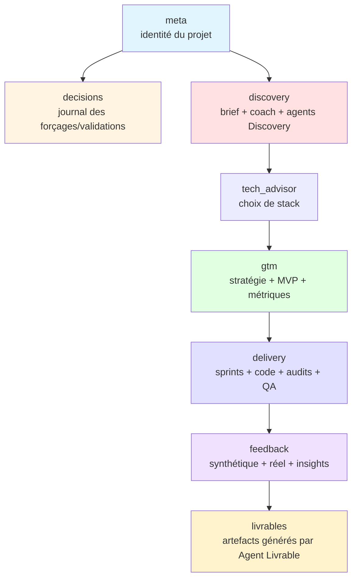

# 🧠 Canvas YAML — Mémoire centrale d'un projet

> **Statut** : Schéma actif — référence pour tous les agents.
> **Rôle** : un seul fichier YAML par projet qui contient **tout** ce que le système sait du projet (contexte, décisions, outputs d'agents, état d'avancement, livrables).
> **Règle de gouvernance** : un **seul écrivain** = LangGraph Orchestrateur. Les agents soumettent, l'Orchestrateur valide et écrit.

---

## 🎯 Pourquoi un Canvas YAML ?

| Sans Canvas | Avec Canvas |
|---|---|
| Chaque agent reconstruit son contexte à chaque run | Tous les agents lisent le même fichier au démarrage |
| Aucune trace centralisée des décisions | Decision Log natif |
| Conflits d'écriture quand plusieurs agents travaillent | Un seul écrivain (Orchestrateur) → zéro conflit |
| Pas de mémoire entre les phases | La phase N consomme les outputs de la phase N-1 |
| Pas de source unique pour les livrables | L'Agent Livrable génère tout depuis le Canvas |

---

## 🧱 Structure choisie — Vision A "par phase du pipeline"



Chaque section correspond à une phase du pipeline. **1 agent = 1 emplacement dédié** dans le Canvas. Zéro chevauchement.

> 💡 La Vision B "par concept métier" (Impact Map, Story Map…) **n'est pas dans le Canvas** — ce sont des **livrables** produits par l'Agent Livrable *à partir du Canvas*.

---

## 📋 Règles d'or

| Règle | Pourquoi |
|---|---|
| **1 projet = 1 fichier YAML** | `projects/<project-id>.yml` |
| **1 seul écrivain** : LangGraph Orchestrateur | Pas de conflit |
| **Les agents soumettent, ne touchent pas directement** | Validation Pydantic avant écriture |
| **Versioning Git** | Historique des décisions via `git log`/`git diff`, pas via journal append-only |
| **Tous les agents lisent le Canvas au démarrage** | Contexte complet, pas d'agent borgne |
| **Le mode (`client`/`perso`) est immuable une fois posé** | Évite les contaminations de configuration |
| **`data_classification_max` est immuable une fois posé** | Évite les escalades silencieuses de sensibilité |
| **Tout forçage humain est tracé dans `decisions`** | Auditabilité |

---

## 📁 Arborescence dans le repo

```
solo-builder-ai/
├── canvas/
│   ├── README.md                       (ce fichier)
│   ├── schema.yml                      (schéma annoté — modèle vide)
│   └── example-cv-interactif.yml       (cas concret rétroactif)
└── projects/                           (au runtime — pas commité par défaut)
    ├── cv-interactif.yml               (cas réel — éventuellement publié si 🟢)
    ├── apport-affaires.yml             (🟠 Sensible — local uniquement)
    └── coaching-sante.yml              (🟠 Sensible — local uniquement)
```

> Le dossier `projects/` n'est **pas commité par défaut**. Selon la classification du projet :
> - 🟢 Public → peut être commité dans `projects/` au repo public
> - 🟡 Interne → repo Git privé
> - 🟠 Sensible → local uniquement, chiffré au repos (sops)
> - 🔴 Critique → ne devrait pas exister sous forme de Canvas

---

## 📐 Schéma type — vue d'ensemble des sections

| Section | Écrit par | Rempli quand |
|---|---|---|
| `meta` | Moi (au démarrage) + Orchestrateur (mise à jour `status`) | Création du projet |
| `decisions` | Orchestrateur à chaque checkpoint | Continu |
| `discovery.brief_initial` | Moi | Démarrage |
| `discovery.coach_interview` | Agent Coach | Phase Discovery |
| `discovery.ember_razor_output` | Agent EMBER+RAZOR (si mode Standard/Complet) | Phase Discovery |
| `discovery.contrarian_output` | Agent CONTRARIAN (si mode Standard/Complet) | Phase Discovery |
| `discovery.judge_verdict` | Agent JUDGE (si mode Standard/Complet) | Fin phase Discovery |
| `tech_advisor` | Agent TECH-ADVISOR | Entre GTM et Delivery |
| `gtm.strategie` | Agent GTM (mode 1) | Phase GTM |
| `gtm.mvp_scope` | Agent GTM (mode 2) | Phase GTM |
| `gtm.metric_setter` | Agent GTM (mode 3) | Phase GTM |
| `delivery.sprints[]` | Agents PM / Dev / Audit Tech / QA E2E / DEPLOY | Phase Delivery itérative |
| `feedback.synthetique` | 4 personas synthétiques | Avant chaque livraison |
| `feedback.reel` | Agent SENTINEL + tracking analytics | Après chaque livraison |
| `feedback.insights` | Insight Synthesizer | Après feedback collecté |
| `livrables.generated[]` | Agent Livrable | Event-driven selon phase |

---

## 🔐 Sécurité du Canvas

Le Canvas est **lui-même une donnée**. Sa classification suit celle du projet :

| Classification projet | Canvas peut être... |
|---|---|
| 🟢 Public | Commité sur Git public OK |
| 🟡 Interne | Git privé OU public si anonymisé |
| 🟠 Sensible | Git privé chiffré uniquement (sops + age) |
| 🔴 Critique | Le projet ne devrait pas exister sous cette forme |

Voir [`policies/data-classification.md`](../policies/data-classification.md) et [`policies/secrets-management.md`](../policies/secrets-management.md#cas-3--le-canvas-yaml-lui-même).

**Aucun secret en clair dans le Canvas** — toujours par référence (`{{ANTHROPIC_API_KEY}}`).

---

## 📚 Voir aussi

- [`schema.yml`](schema.yml) — schéma annoté complet (modèle vide commenté)
- [`example-cv-interactif.yml`](example-cv-interactif.yml) — exemple concret appliqué au CV interactif
- [`../policies/perso-profile.md`](../policies/perso-profile.md) — profil perso (modes Discovery, assouplissements)
- [`../agents/_TEMPLATE.md`](../agents/_TEMPLATE.md) — template de spec d'agent (chaque agent référence sa section Canvas)
