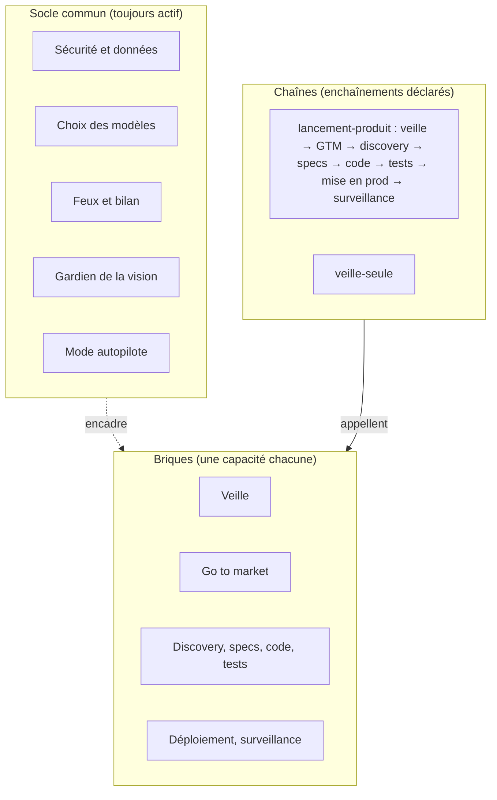

# Architecture de Solo Builder : un socle, des briques, des chaînes

> **Statut** : décidée par Vincent le 24/11/2026, rédigée le 26/11/2026 · **Version** : 1.0
> **En une phrase** : Solo Builder n'est pas un grand système unique mais un **socle commun** qui encadre des **briques** spécialisées, assemblées en **chaînes** selon le besoin.

---

## 1. Pourquoi cette architecture

Solo Builder doit évoluer au fil des besoins : aujourd'hui le développement de produits, demain le contenu, la prospection ou des outils personnels. Ajouter une capacité ne doit jamais obliger à tout reprendre.

Trois options ont été comparées :

| Option | Verdict | Raison |
|---|---|---|
| Un grand système qui fait tout | ❌ Écartée | Chaque agent lit les règles de tous, le contexte grossit, les erreurs sont difficiles à localiser, et il faut tout construire avant d'utiliser quoi que ce soit |
| Plusieurs petits systèmes indépendants | ❌ Écartée seule | Chacun finit par réinventer ses propres règles, qui divergent |
| **Un socle commun + des briques + des chaînes** | ✅ Retenue | Les règles vivent à un seul endroit, les briques se réutilisent, une nouvelle idée est une nouvelle chaîne |

---

## 2. Les trois niveaux



| Niveau | Ce que c'est | Exemple |
|---|---|---|
| **Socle** | Les règles qui s'appliquent partout. Il ne produit rien lui-même : il encadre tout ce qui tourne | « Données de test seulement en autopilote », « jamais de déploiement automatique en production » |
| **Brique** | Une capacité précise, réutilisable, rangée dans une famille (veille, business, développement, DevOps, contenu) | CONTRARIAN, qui cherche les défauts fatals d'une idée |
| **Chaîne** | Une suite d'étapes prévue à l'avance, qui peut mélanger les familles, avec un point de contrôle entre les étapes | Veille, puis Go to market, puis Discovery, puis specs, code, tests, mise en production, surveillance |

---

## 3. Les quatre principes

1. **Chaque brique a un contrat** : ce qu'elle reçoit, ce qu'elle produit, sa définition de terminé, son niveau de risque, son modèle, les données qu'elle a le droit de voir, et ce qu'elle ne fait pas. C'est ce contrat qui permet de brancher n'importe quelle brique derrière une autre.
2. **Les briques se passent le travail par le Canvas**, jamais directement. Une brique écrit son résultat, la suivante le lit. **Un seul écrivain à la fois** : l'orchestrateur valide puis écrit (voir [`canvas/`](../canvas/)).
3. **Une chaîne est un fichier, pas du code** : une liste d'étapes et de points de contrôle. Ajouter une chaîne revient à écrire une liste.
4. **Le socle s'applique tout seul à chaque brique.** Une brique peut **durcir** une règle du socle, jamais l'assouplir.

---

## 4. Compétence par défaut, sous-agent par exception

Une brique n'est pas forcément un agent séparé. Les systèmes multi-agents consomment environ **15 fois plus de tokens** qu'une conversation simple (mesure d'Anthropic), et le passage de relais entre agents est leur première cause d'échec.

| Forme | Quand | Pourquoi |
|---|---|---|
| **Compétence** (par défaut) | Presque toujours | Une fiche d'instructions que l'agent en cours charge au moment voulu. Elle ne coûte presque rien tant qu'elle ne sert pas |
| **Sous-agent** (exception) | Seulement si l'un de ces trois cas s'applique : travail **en parallèle** (une veille sur plusieurs sources), **jugement indépendant** (le comité qui conteste ne doit pas être celui qui a produit), **contexte trop lourd** pour un seul agent | Un contexte séparé protège la qualité, au prix de tokens en plus |

Deux règles de croissance :
- **Une brique n'existe que quand une chaîne réelle s'en sert.** On ne construit pas le catalogue d'avance.
- **Réutiliser d'abord, spécialiser quand l'usage le prouve.** La prospection commence avec la brique Veille et d'autres réglages ; elle ne devient une brique à part que si une vraie différence apparaît.

---

## 5. Le contrat d'une brique

Dans le dépôt privé, chaque brique est une compétence au format standard [Agent Skills](https://agentskills.io/) : un dossier contenant un fichier `SKILL.md`. L'en-tête porte le contrat, le corps porte les instructions. Les specs détaillées du dossier [`agents/`](../agents/) restent la référence de conception.

```markdown
---
name: dev-contrarian
description: Cherche les défauts fatals d'une idée avant tout développement. À utiliser après EMBER+RAZOR, avant JUDGE.
famille: developpement
forme: sous-agent            # compétence | sous-agent
raison_sous_agent: jugement indépendant
entrees: [canvas.discovery.ember_razor]
sorties: [canvas.discovery.contrarian]
definition_de_termine: "Chaque défaut a un identifiant, une gravité, une question de résolution et une preuve citée."
risque: moyen                 # faible | moyen | élevé
modele: claude-opus-5-5       # Fable 5.2 sur un projet client
donnees_max: interne          # public | interne | sensible
ne_fait_pas: ["trancher le go / no-go (JUDGE)", "proposer une solution (GTM)"]
---

Instructions de la brique…
```

La **définition de terminé** est obligatoire : une étude de Berkeley sur plus de 200 tâches montre qu'une large part des échecs des systèmes multi-agents vient d'une vérification absente ou bâclée, dont l'arrêt prématuré.

---

## 6. Le format d'une chaîne

Une chaîne est un fichier YAML dans `chaines/`. L'orchestrateur (la session Claude Code qui exécute la chaîne) le lit et déroule les étapes dans l'ordre.

```yaml
nom: lancement-produit
description: De la veille sur un sujet jusqu'à la mise en production surveillée.
etapes:
  - brique: veille-sujet
  - brique: business-gtm
    controle: go_vincent          # Vincent valide la stratégie et le périmètre
  - brique: dev-ember-razor
  - brique: dev-contrarian
  - brique: dev-judge
    controle: go_vincent          # go / no-go
  - brique: dev-pm
    controle: go_vincent          # validation des specs
  - brique: dev-code
  - brique: dev-audit-tech
    controle: feu                 # 🔴 bloque, 🟠 signalé, 🟢 continue
  - brique: dev-qa-e2e
    controle: go_vincent          # recette
  - brique: devops-deploy
    controle: go_vincent          # jamais de déploiement automatique en production
  - brique: devops-sentinel
```

| Point de contrôle | Effet |
|---|---|
| `feu` | Le feu de l'étape décide : 🟢 la chaîne continue, 🟠 elle continue et le signale au bilan, 🔴 elle s'arrête sur cette branche |
| `go_vincent` | La chaîne s'arrête et attend Vincent. En autopilote, c'est la fin du run sur cette chaîne : le bilan présente ce qui attend sa décision |

---

## 7. Le rangement

```text
solo-builder-system/            (dépôt privé)
├── CLAUDE.md                   charge le socle à chaque session
├── AUTOPILOTE.md               consignes du mode autopilote
├── socle/                      règles détaillées : sécurité, données, modèles, feux, bilan
├── .claude/
│   ├── settings.json           interdictions (fichier protégé)
│   ├── skills/                 les briques sous forme de compétences
│   │   ├── veille-sujet/SKILL.md
│   │   ├── business-gtm/SKILL.md
│   │   └── dev-pm/SKILL.md …
│   └── agents/                 les briques sous forme de sous-agents
│       ├── dev-contrarian.md
│       └── dev-audit-tech.md …
├── chaines/
│   ├── lancement-produit.yml
│   └── veille-seule.yml
└── canvas/                     schéma et Canvas des projets
```

Claude Code découvre automatiquement les compétences de `.claude/skills/` et les sous-agents de `.claude/agents/`. La famille d'une brique se lit dans son nom (`veille-`, `business-`, `dev-`, `devops-`, `contenu-`) et dans son champ `famille`. Plus tard, une famille entière pourra devenir un paquet installable séparément (plugin), si le besoin apparaît.

**Correspondance des 14 agents actuels** :

| Famille | Briques |
|---|---|
| `business-` | GTM, PM |
| `dev-` | Coach, EMBER+RAZOR, CONTRARIAN, JUDGE, TECH-ADVISOR, Dev, Audit Tech, QA E2E |
| `devops-` | DEPLOY, SENTINEL |
| Transverse | Insight Synthesizer, Livrable |
| `veille-` | À créer quand la première chaîne en aura besoin |

---

## 8. Le socle

| Élément | Où il vit aujourd'hui |
|---|---|
| Sécurité, défense en profondeur | [`SECURITY.md`](../SECURITY.md) |
| Classification et routage des données | [`policies/data-classification.md`](../policies/data-classification.md) |
| Injection de prompt, secrets, profil perso | [`policies/`](../policies/) |
| Choix des modèles | [`agents/light-specs.md`](../agents/light-specs.md#-répartition-des-modèles) |
| Feux, bilan, comités | [`AUTOPILOTE.md`](../AUTOPILOTE.md) |
| Gardien de la vision | À spécifier : il rédige les critères d'acceptation avant chaque mission |

Dans le dépôt privé, ces éléments sont repris dans `socle/` et chargés par `CLAUDE.md`. Règle : un élément du socle n'existe qu'à un seul endroit, les briques y renvoient.

---

## 9. Deux dépôts

| | Public `solo-builder-ai` | Privé `solo-builder-system` |
|---|---|---|
| Rôle | Vitrine : montrer la démarche et la conception | Le système qui tourne au quotidien |
| Contenu | Conception, socle, specs des agents, ce document, **un exemple exécutable CrewAI + LangGraph** | Socle actif, briques (compétences et sous-agents), chaînes |
| Moteur | CrewAI + LangGraph via l'API Anthropic : la version pour les systèmes livrés aux clients | Claude Code, sur l'abonnement Claude Max (jamais l'API) |
| Autopilote | Branché depuis le 20/11/2026 | À brancher avec la procédure |

Pourquoi deux moteurs : Claude Code lit nativement les compétences et les sous-agents, donc le système perso fonctionne sans écrire de code d'orchestration. Un client, lui, a besoin d'un système qu'il peut héberger et faire tourner sur sa propre clé d'API : c'est le rôle de CrewAI et LangGraph.

---

## 10. L'autopilote, un mode d'exécution du socle

L'autopilote n'est pas une partie du développement : c'est une **façon de faire tourner n'importe quelle chaîne sans Vincent**. Aujourd'hui il exécute des missions de développement et de documentation ; demain il pourra rédiger des brouillons de contenu la nuit, que Vincent trie le matin. Ses règles (rien en production sans le go de Vincent, données de test seulement, feux, bilan) font partie du socle et s'appliquent à toute chaîne qu'il exécute. Voir [`AUTOPILOTE.md`](../AUTOPILOTE.md).

---

## 11. Ce qui a été écarté

| Idée | Pourquoi non |
|---|---|
| Des agents séparés partout | Coût en tokens (environ 15 fois plus), quota de l'abonnement épuisé plus vite, relais fragiles |
| Plusieurs briques qui écrivent en même temps sur un projet | Décisions incompatibles entre agents, difficiles à réconcilier (retour d'expérience de Cognition) |
| Reprendre tel quel un framework existant (BMad Method, wshobson/agents) | Pas de socle de sécurité comparable ; un paquet tiers peut contenir des scripts qui s'exécutent. On s'en inspire, on lit tout ce qu'on reprend |
| Construire tout le catalogue de briques d'avance | Sur-construction : une brique naît d'une chaîne réelle |

---

## 12. Points ouverts

- ~~Fichiers protégés de l'autopilote dans le dépôt privé~~ **Décidé par Vincent le 26/11/2026** : dans le dépôt privé, seule `.claude/settings.json` reste 🔴 ; toute création ou modification d'une brique (`.claude/skills/`, `.claude/agents/`) est 🟠 et signalée explicitement au bilan, puisqu'une brique devient une consigne pour les sessions suivantes. À inscrire dans l'`AUTOPILOTE.md` du dépôt privé.
- **Gardien de la vision** : brique à spécifier.
- **Format exact du Canvas en compétences** : à valider sur la première chaîne convertie.
- **Choix d'un sous-agent en Fable 5.2 dans Claude Code** : à vérifier au premier run qui contient du code.

---

## 13. Sources

- Anthropic, [Building effective agents](https://www.anthropic.com/research/building-effective-agents) : workflows prévus à l'avance, motif *evaluator-optimizer*, commencer simple
- Anthropic, [How we built our multi-agent research system](https://www.anthropic.com/engineering/multi-agent-research-system) : coût en tokens, consignes précises par sous-agent, cas où le multi-agents ne convient pas
- Cognition, [Don't build multi-agents](https://cognition.ai/blog/dont-build-multi-agents) : le passage de contexte entre agents comme cause d'échec
- Cemri et al., [Why Do Multi-Agent LLM Systems Fail?](https://arxiv.org/abs/2503.13657) : 14 modes d'échec, dont la vérification absente
- HumanLayer, [12-Factor Agents](https://www.humanlayer.com/blog/12-factor-agents) : de petits agents dans un système en grande partie déterministe
- [Agent Skills](https://agentskills.io/) : format standard des compétences, chargement progressif
- [wshobson/agents](https://github.com/wshobson/agents) et la BMad Method : briques par domaine, modules d'extension
