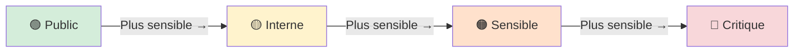
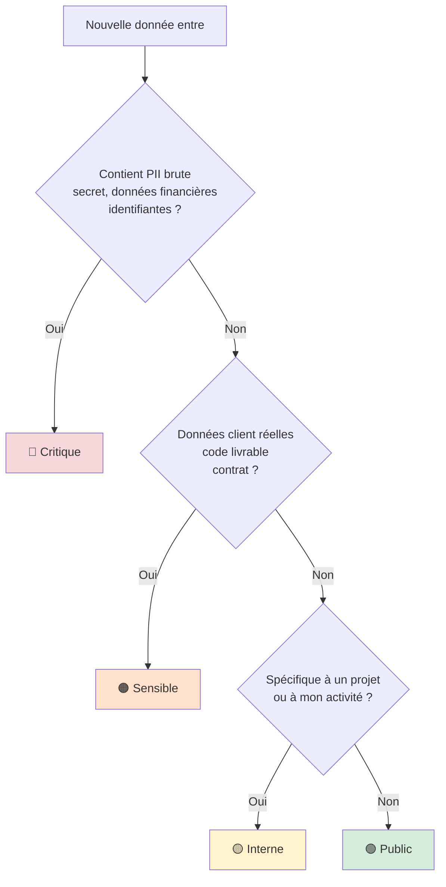

# 📊 Classification des données

> **Statut** : Sprint 1 sécu — référence active.
> **Rôle** : règle de routage des données dans le système. Détermine **où** une donnée peut transiter (API LLM externe, modèle local, jamais).
> **Maître** : [`SECURITY.md`](../SECURITY.md)

---

## 📐 Pourquoi classifier ?

Chaque donnée qui entre dans le système doit être étiquetée avant tout traitement. Sans classification :
- Risque RGPD si données personnelles envoyées hors UE sans base légale
- Risque NDA client si données sensibles transitent par une API non couverte
- Risque réputationnel si secrets/PII apparaissent dans des logs

**Règle d'or** : *en cas de doute, on classe au niveau supérieur*. Pas l'inverse.

---

## 🎯 Les 4 niveaux



### 🟢 Niveau 1 — Public

**Définition** : information déjà publique ou destinée à l'être, ne révèle rien de confidentiel sur un client, un partenaire ou moi-même.

| Exemples | Routage autorisé |
|---|---|
| Brief d'idée générique (*"un CRM pour PME"*) | ✅ API Anthropic |
| Recherche marché sur sources publiques (Reddit, HN, Crunchbase, Data.gouv) | ✅ API Anthropic |
| Choix techniques génériques (*"on hésite Postgres ou Mongo"*) | ✅ API Anthropic |
| Données INSEE / Data.gouv brutes | ✅ API Anthropic |
| Templates de livrables génériques | ✅ API Anthropic |
| Documentation publique du système | ✅ API Anthropic + Git public |

---

### 🟡 Niveau 2 — Interne

**Définition** : info propre à un projet ou à mon activité, pas confidentielle au sens strict mais pas à diffuser. Aucune donnée personnelle identifiante (PII) ni secret.

| Exemples | Routage autorisé |
|---|---|
| Brief d'un projet client (formulation neutre, sans nom client réel) | ✅ API Anthropic **après anonymisation amont** |
| User stories, critères d'acceptance, specs internes | ✅ API Anthropic |
| Choix d'architecture pour un projet donné | ✅ API Anthropic |
| Roadmap interne, priorisation backlog | ✅ API Anthropic |
| Code générique (sans logique métier client) | ✅ API Anthropic |

**Règle d'anonymisation amont** : tout nom de client, partenaire, prospect → remplacé par `CLIENT_A`, `PARTENAIRE_X`, etc. **avant** injection LLM. Mapping conservé hors-LLM, dans un fichier `.env` local jamais commité.

---

### 🟠 Niveau 3 — Sensible

**Définition** : données dont la fuite porterait préjudice — au client, à un utilisateur, ou à moi. Inclut le code livrable client, les contrats, les données clients réelles.

| Exemples | Routage autorisé |
|---|---|
| Données utilisateurs réelles d'un client (même partielles) | 🟠 **Ollama local uniquement** |
| Code source livrable client (avec logique métier identifiable) | 🟠 **Ollama local uniquement** |
| Contrats clients, devis, NDA signés | 🟠 **Ollama local uniquement** |
| Données financières client (CA, marges, prix négociés) | 🟠 **Ollama local uniquement** |
| Logs applicatifs contenant des identifiants utilisateurs | 🟠 **Ollama local uniquement** |
| Communications privées (emails, Slack) | 🟠 **Ollama local uniquement** |

**Conséquence pratique** :
- Pas d'API Anthropic. Le moteur LLM est **Ollama local** sur Mac Mini M2 (Llama 3 ou Mistral).
- Le Mac Mini M2 fait office de "zone sensible" — pas connecté à des services externes pendant le traitement.
- Le Canvas YAML d'un projet niveau Sensible n'est **pas synchronisé sur GitHub public**. Il reste en local ou dans un dépôt privé chiffré.

---

### 🔴 Niveau 4 — Critique

**Définition** : tout secret, toute PII brute, toute donnée dont la fuite est juridiquement ou financièrement catastrophique. **Aucun LLM ne doit jamais les voir.**

| Exemples | Routage autorisé |
|---|---|
| Clés API (Anthropic, OpenAI, MCP, providers) | ❌ Jamais en LLM — Keychain macOS / `.env` chiffré |
| Mots de passe, tokens d'authentification | ❌ Jamais en LLM — gestionnaire dédié |
| PII brutes (NIR, RIB, n° carte, passeport) | ❌ Jamais en LLM — stockage chiffré, accès humain |
| Données de santé, données pénales | ❌ Jamais en LLM — RGPD strict, sortie du système |
| Secrets industriels clients explicitement marqués | ❌ Jamais en LLM — sortie du système |

**Conséquence pratique** :
- Ces données ne doivent **jamais transiter** par un agent, même local.
- Si un brief client contient du niveau 4 → anonymisation/extraction manuelle avant d'entrer dans le système.
- Les clés API restent dans le Keychain macOS ou un gestionnaire (1Password CLI). Chargées au runtime via variables d'environnement, jamais en clair dans le code ou les configs.

---

## 🔀 Tableau de routage condensé

| Niveau | API Anthropic | Ollama local | Git public | Git privé chiffré | Logs |
|---|:---:|:---:|:---:|:---:|:---:|
| 🟢 Public | ✅ | ✅ | ✅ | ✅ | ✅ |
| 🟡 Interne | ✅ (anonymisé) | ✅ | ❌ | ✅ | ✅ filtré |
| 🟠 Sensible | ❌ | ✅ | ❌ | ✅ | ✅ filtré + audit |
| 🔴 Critique | ❌ | ❌ | ❌ | ❌ (hors système) | ❌ |

---

## 🪪 Qui classe une donnée ? Quand ? Comment ?

### Quand
**Au moment où la donnée entre dans le système** — c'est-à-dire :
- À l'ingestion du brief initial par moi
- À la première écriture dans le Canvas YAML
- À la connexion d'une nouvelle source (MCP, API, fichier)

### Qui
**Moi en premier lieu** — pour chaque projet, je détermine le **niveau plafond** du projet (le maximum atteignable). Ce niveau est inscrit dans le Canvas :

```yaml
meta:
  project_id: projet-001
  data_classification_max: sensible  # public | interne | sensible | critique
```

Les agents lisent ce champ et **ne peuvent pas dépasser** cette limite. Si un agent doit traiter une donnée plus sensible que le plafond du projet, il **bloque** et escalade.

### Comment (procédure de classification)



> 💡 **Règle du doute** : si l'arbre te fait hésiter à un nœud → tu réponds *oui* (niveau supérieur).

---

## 🧹 Anonymisation amont — quand et comment

Obligatoire pour tout traitement Niveau Interne via API Anthropic. Recommandé même en local.

### Ce qui doit être remplacé systématiquement

| Type | Avant | Après |
|---|---|---|
| Noms de clients/partenaires | "Société Dupont SARL" | `CLIENT_A` |
| Noms de personnes | "Marc Bertrand, DSI" | `PERSONNE_1` (rôle préservé : DSI) |
| Emails | "marc.bertrand@dupont.fr" | `EMAIL_1` |
| Numéros de téléphone | "06.12.34.56.78" | `TEL_1` |
| Adresses | "12 rue de Rivoli, Paris" | `ADRESSE_1` (ville préservée si pertinent) |
| RIB / IBAN | "FR76 1234 …" | ❌ **Bloquer** (Niveau 4) |
| N° SIRET / SIREN | "12345678900012" | `SIRET_1` |
| Données financières précises | "CA 2024 : 2,3 M€" | "CA : ordre de grandeur 2-3M€" |

### Outils
- **Premier niveau** : regex (emails, téléphones, RIB) — déterministe, fiable
- **Deuxième niveau** : `presidio` (Microsoft, open source) — détection NER avancée des entités
- **Troisième niveau** : LLM local via Ollama (Mac Mini M2) sur le brief pour repérer ce qui aurait échappé

> ⚠️ **Toute la chaîne d'anonymisation est locale.** Aucun modèle Claude (Haiku, Sonnet, Opus, Fable) n'est accessible en local : ce sont des modèles API. Les utiliser à cette étape enverrait les données brutes chez Anthropic, ce qui annulerait l'anonymisation.

**Mapping de réversibilité** : conservé localement dans `.anonymization-map.json` (chiffré, jamais commité, jamais transmis). Utilisé uniquement pour reconstruire les livrables finaux avec les vrais noms si le client le demande.

---

## 🚦 Conséquences sur le pipeline

Chaque agent doit déclarer son **niveau de classification max accepté** dans sa spec (`agents/_TEMPLATE.md` → section "Sécurité & sources").

| Agent | Niveau max accepté | Raison |
|---|---|---|
| EMBER+RAZOR | 🟡 Interne | Recherche web — API Anthropic OK avec anonymisation |
| CONTRARIAN | 🟡 Interne | Analyse uniquement le brief anonymisé |
| JUDGE | 🟡 Interne | Verdict sur données déjà anonymisées |
| Agent GTM | 🟡 Interne | Idem |
| Agent PM | 🟡 Interne | Spécifications sur brief anonymisé |
| Agent Dev | 🟠 Sensible | Produit du code livrable client → Ollama local obligatoire |
| Agent Audit Tech | 🟠 Sensible | Lit le code livrable → CLI local sans LLM (Bandit, etc.) |
| Agent QA E2E | 🟠 Sensible | Tests sur livrable client réel → environnement isolé |
| Insight Synthesizer | 🟠 Sensible | Croise feedback réel avec données utilisateurs client |
| Agent Livrable | 🟡 Interne | Génère docs clients depuis Canvas anonymisé, puis désanonymisation locale |

> ⚠️ **Conséquence forte** : tout projet client de niveau Sensible **nécessite Ollama local fonctionnel**. C'est un blocage potentiel si Ollama tombe en panne. À ce moment-là, le pipeline s'arrête et m'attend.

---

## 📝 Décisions ouvertes

- [ ] Faut-il chiffrer le `.anonymization-map.json` au repos (au-delà de l'exclure de Git) ?
- [ ] Quel choix précis Llama 3 vs Mistral pour Ollama local — à benchmarker sur le contexte FR
- [ ] Politique de rétention : combien de temps on garde les Canvas YAML de projets clôturés (Sensible → suppression à J+90 ? J+365 ?)
- [ ] Faut-il un coffre type Vault pour les briefs clients en attente de traitement ?
