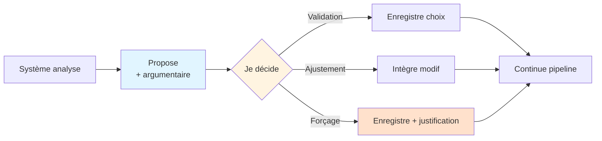
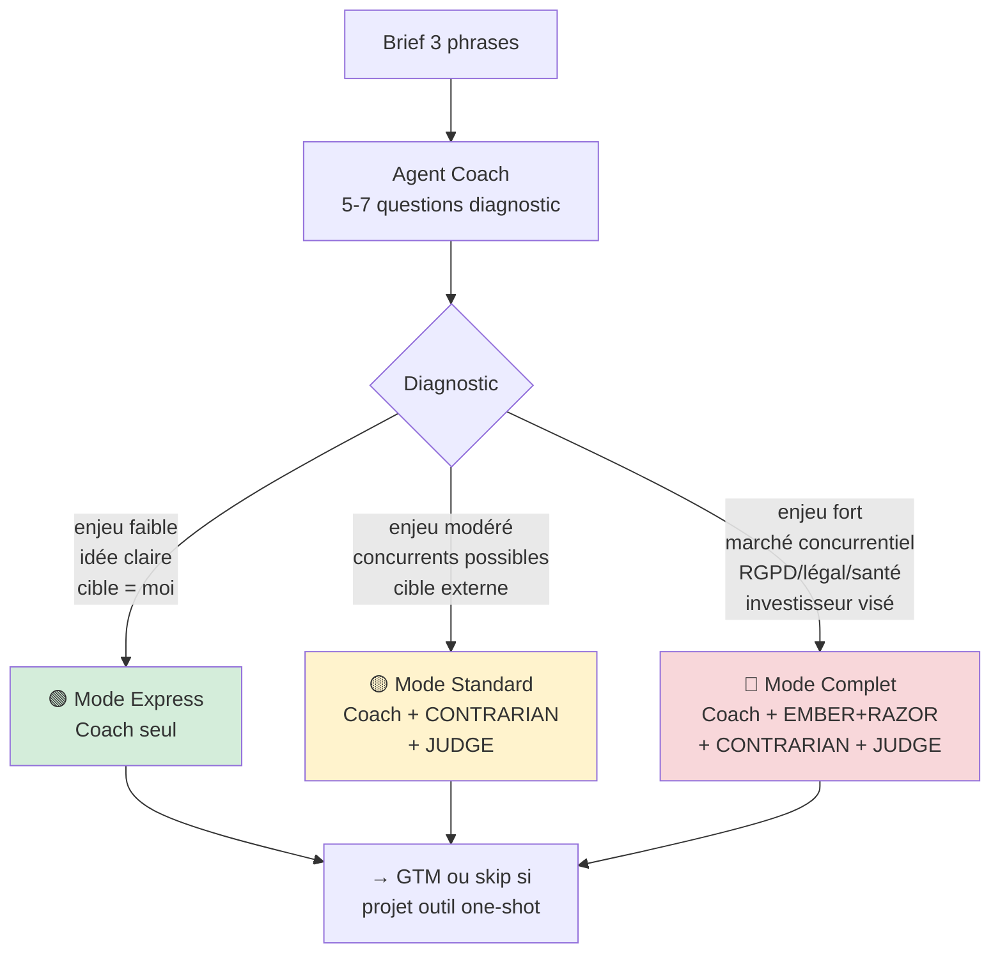

# 👤 Profil `perso` — Politique d'usage personnel

> **Statut** : Sprint 3 — référence active.
> **Audience** : moi-même (Vincent), pour tous mes projets perso/internes (non-client).
> **Maître** : [`SECURITY.md`](../SECURITY.md) (qui reste la baseline non négociable).
> **Mode par défaut** : `perso` jusqu'à ce que je travaille pour un client réel.

---

## 🎯 Philosophie

Mes projets perso ne sont **pas des jouets**. Ils ont des enjeux réels (santé, business, image, time-to-market). La différence avec un projet client n'est **pas le niveau de qualité ou de sécurité** — c'est :

| Axe | Mode `client` | Mode `perso` |
|---|---|---|
| **Audience finale** | Le client + son équipe | Moi seul (en tant que PM) |
| **Validation des choix techniques** | Avec le client | Système autonome, défaut "qualité max" |
| **Communication** | Livrables formels | Logs internes |
| **Cadence** | Selon contrat | Aussi rapide que possible |
| **Tolérance à l'autonomie agent** | Mesurée | Élevée |

**Conséquence** : le système est plus **proactif** et plus **autonome** en perso. Pas plus permissif sur la sécu ou la qualité.

---

## 🔄 Pattern fondamental — "Système propose, je décide"

Partout où le système doit faire un choix structurant, il **propose** une recommandation argumentée puis **j'arbitre**. Je peux toujours :

1. ✅ **Valider** la proposition → le système enregistre et continue
2. 🔄 **Ajuster** la proposition → je modifie, le système intègre et continue
3. 🛑 **Forcer** une décision opposée → le système l'enregistre dans le Decision Log et continue (avec la justification de mon choix)

### Les 5 décisions où ce pattern s'applique systématiquement

| Décision | Quel agent propose | Critères de proposition |
|---|---|---|
| **Mode Discovery** (Express / Standard / Complet) | Coach | Enjeu, cible, dimension légale, niveau d'incertitude |
| **Stack technique** | TECH-ADVISOR | Tier minimum couvrant le besoin, maintenabilité non-dev |
| **Scope MVP** (Must / Should / Later) | GTM Scoper | Effort vs valeur, dépendances, time-to-first-user |
| **Critères pivot/persévère** | Metric Setter | Cible utilisateur, fenêtre temporelle, seuil signification |
| **Go en production** | DEPLOY + SENTINEL | Audit vert, E2E vert, KPIs préliminaires acceptables |

Tout forçage est inscrit dans le Decision Log avec :
- Décision système initiale
- Mon choix final
- Ma justification (texte libre)
- Date

---

## 🔍 Discovery modulaire — 3 modes

### Économie de tokens

| Mode | Tokens estimés (entrée + sortie) | Économie vs Complet |
|---|---|---|
| 🟢 Express | ~3-5k | -80% |
| 🟡 Standard | ~10-15k | -50% |
| 🔴 Complet | ~25-35k | référence |

### Critères de routage Coach

Les 5-7 questions du Coach mesurent :

| Question | Score qui pousse vers Complet |
|---|---|
| Y a-t-il des utilisateurs autres que toi ? | Oui → +1 |
| Le projet a-t-il des contraintes légales (RGPD, fiscal, santé) ? | Oui → +2 |
| Y a-t-il un marché concurrentiel à challenger ? | Oui → +1 |
| As-tu besoin d'arguments pour convaincre (investisseur, partenaire) ? | Oui → +2 |
| L'idée est-elle claire dans ta tête ? | Non → +1 |
| Y a-t-il un budget significatif engagé (temps ou argent) ? | Oui → +1 |
| Délai serré ? | Oui → -1 (pousse vers Express si tout le reste est faible) |

**Score 0-1 → Express · 2-4 → Standard · 5+ → Complet**

> Je peux **toujours** forcer un mode différent.

---

## 🧱 Profil `perso` vs profil `client` — assouplissements explicites

### Ce qui reste **identique**

| Aspect | Pourquoi |
|---|---|
| Sécu données / classification 4 niveaux | RGPD perso aussi |
| Anonymisation systématique pour API LLM (sauf si données 🟢 Public) | Reflexe pro |
| Validation Pydantic stricte | Garde-fou gratuit |
| Quality gates code (sécu + qualité bloquantes) | Tu ne lis pas le code |
| Tests adversariaux sur agents critiques | Le risque d'injection ne disparaît pas en perso |
| Sandboxing code généré | Isolation infrastructure |
| Secrets jamais en LLM | Catastrophe identique en perso |
| Pre-commit hooks (gitleaks) | Gratuit en effort |
| Répartition des modèles (Opus 5.5 décisions et code · Sonnet 5.5 production · Haiku 5.5 synthèse) | L'écart de prix Opus/Sonnet (×2) ne justifie plus de dégrader les décisions en perso |

### Ce qui **s'assouplit**

| Aspect | Mode `client` | Mode `perso` | Justification |
|---|---|---|---|
| **Revues externes** | Trimestrielles + pré-livraison | Annuelle seulement | Pas de client à protéger |
| **Anonymisation amont** | Obligatoire pour API | Optionnelle (tes données t'appartiennent) | Friction réduite |
| **RC Pro / DPA / NDA** | Obligatoires | Optionnel | Pas de tiers exposé |
| **Decision Log** | Exhaustif | Essentiel uniquement (forçages + pivots) | Moins de poids |
| **Agent Livrable (6 docs clients)** | Actif par défaut | Désactivable par défaut | Personne à informer |
| **Checkpoints humains non-techniques** | Tous bloquants | Skippables avec flag explicite (pour Discovery Express) | Fluidité |
| **Mise en prod** | Selon contrat client | Automatique avec garde-fous | Time-to-test |
| **Sentinelle post-prod** | Selon contrat client | **Active par défaut** | Tu ne sauras pas debug seul |
| **Coût total cible** | 100-200€/projet selon ampleur | 5-30€/projet (mode Express courant) | Marge perso |

### Ce qui s'**ajoute** en perso (proactivité)

| Comportement proactif | Comment |
|---|---|
| **Coach pose les questions** | Au lieu d'analyser passivement, il interroge avant d'analyser |
| **TECH-ADVISOR propose des options non sollicitées** | Suggère des tiers de stack même si tu n'as pas demandé |
| **Audit Tech recommande des fixes** | Au lieu de juste signaler, propose la correction en langage métier |
| **SENTINEL agit dans la zone safe** | Petits fix routiniers (renouvellement cert, redéploiement après glitch) sans demander |
| **Insight Synthesizer fait des suggestions** | Ne se contente pas de croiser feedback, propose le prochain pas |

---

## 💰 Optimisation tokens en mode `perso` — 5 leviers

Cumulés sur un projet Express perso : **80-90% d'économie** vs profil client strict, sans rien sacrifier en qualité/sécu.

| Levier | Économie | Comment |
|---|---|---|
| **1. Discovery modulaire** (Express par défaut) | -70% sur projets simples | Coach diagnostique, route automatiquement |
| **2. Prompt caching Anthropic** | -90% sur system prompts répétés | Activation native API, 0 effort |
| **3. Bon modèle au bon endroit** (Haiku 5.5 synthèse/surveillance · Sonnet 5.5 production · Opus 5.5 décisions et code) | Haiku 5.5 coûte 40 fois moins qu'Opus 5.5 en entrée | Répartition fixe, identique en perso et en client |
| **4. Ollama local** (anonymisation, reformatage, classification) | Gratuit après hardware Mac Mini M2 | Routage par classification |
| **5. Skip agents non pertinents** | -10-20% selon projet | Agent Livrable désactivé en perso, etc. |

### Stratégies de skip agents en mode perso

| Agent | Skippable en perso ? | Quand |
|---|---|---|
| Coach | ❌ jamais | Point d'entrée |
| EMBER+RAZOR | ✅ en Express/Standard | Décidé par Coach |
| CONTRARIAN | ✅ en Express | Décidé par Coach |
| JUDGE | ✅ en Express | Décidé par Coach |
| Agent GTM | ✅ si projet "outil one-shot" sans cible utilisateur | Manuel |
| TECH-ADVISOR | ✅ si stack imposée par moi | Manuel |
| Agent PM | ❌ jamais (sauf no-code pur) | — |
| Agent Dev | ❌ jamais (sauf no-code pur) | — |
| Agent Audit Tech | ❌ jamais | — |
| Agent QA E2E | ✅ si pas d'UI | Auto-détecté |
| Insight Synthesizer | ✅ si pas d'utilisateurs externes | Décidé par moi en GTM |
| Agent Livrable | ✅ par défaut en perso | Activable à la demande |
| SENTINEL | ❌ jamais (en prod) | — |
| DEPLOY | ✅ si pas de déploiement (script local) | Auto-détecté |

---

## 📚 Catalogue de mes projets — application du profil

### Projet 1 — Apport d'affaires (existant — `contexte/projet_apport_affaires.md`)

| Item | Choix |
|---|---|
| Classification données | 🟠 Sensible (réseau, TJM, mention employeur) |
| Mode Discovery | 🔴 Complet (juridique + concurrentiel + commission) |
| Stack technique | Tier 0 no-code (Airtable + Make + Apify + Waalaxy + Yousign) — **forcée par moi** |
| Niveau d'autonomie système | Élevée (je connais mon domaine, peu de surprises) |
| Sentinelle | Basique (monitoring webhooks Make + alertes Airtable) |
| Agent Livrable | Off (pas de client à informer) |

### Projet 2 — Coaching santé (existant — `contexte/projet_coaching_sante/`)

| Item | Choix |
|---|---|
| Classification données | 🟠 Sensible (données santé personnelles, catégorie spéciale RGPD) |
| Mode Discovery | 🔴 Complet (RGPD santé sensible si jamais publication) |
| Stack technique | Tier 1 HTML statique (déjà v4) — possible évolution Tier 3 si publication |
| Niveau d'autonomie système | Très élevée (single-user, pas de risque externe) |
| Sentinelle | Aucune (app locale, pas de prod) |
| Agent Livrable | Off |

### Projet 3 — CV interactif (existant — `~/projects/cv/` déployé Vercel)

| Item | Choix |
|---|---|
| Classification données | 🟢 Public (déjà en ligne) |
| Mode Discovery | 🟢 Express (idée claire, pas de concurrent à challenger) |
| Stack technique | Tier 2 JAMstack (Astro + Vercel) — déjà en place |
| Niveau d'autonomie système | Élevée |
| Sentinelle | Active (downtime alerte + monitoring SEO basique) |
| Agent Livrable | Off |

### Projet 4 — Programme d'objectifs personnels (à venir)

| Item | Choix |
|---|---|
| Classification données | 🟠 Sensible (vie privée, objectifs intimes) |
| Mode Discovery | 🟢 Express (cible = toi seul, pas de marché) |
| Stack technique | Tier 1 HTML statique probable |
| Niveau d'autonomie système | Très élevée |
| Sentinelle | Aucune |
| Agent Livrable | Off |

### Projet 5 — Création site web (à venir, selon ambition)

| Item | Choix possible |
|---|---|
| Classification données | 🟢 Public à 🟡 Interne |
| Mode Discovery | 🟢 Express à 🟡 Standard selon ambition (vitrine vs conversion) |
| Stack technique | Tier 2 JAMstack (Astro / Next.js) |
| Niveau d'autonomie système | Élevée |
| Sentinelle | Active (SEO, perf, downtime) |
| Agent Livrable | Off |

---

## 🚦 Transition `perso` → `client` (futur)

Un projet ne peut **pas** changer de mode en cours de route. Si je décide de transformer un projet perso en projet commercial (typiquement le coaching santé), procédure :

1. **Nouveau projet** créé dans le Canvas avec `mode: client`
2. **Migration sélective** des artefacts du projet perso (Discovery, choix de stack, code peuvent être réutilisés)
3. **Re-passage de la sécu en mode client** :
   - Anonymisation systématique réactivée
   - Tests adversariaux réactivés
   - Revues externes planifiées
   - Pré-flight checklist obligatoire avant livraison
   - DPA / NDA si tiers impliqué
4. **Decision Log dédié** pour tracer le passage

Pas de bascule "en place" pour éviter contamination de configuration.

---

## 📝 Décisions ouvertes

- [ ] Doit-on activer `Agent Livrable` par défaut en mode `perso` mais en mode "léger" (1 page de récap par sprint) au lieu de off complet ?
- [ ] Niveau de proactivité du SENTINEL en perso : où placer la barre entre "il agit" et "il demande" ?
- [ ] Cas du **CV interactif** — on l'intègre comme **cas test rétroactif** du système (on documente ce qui aurait dû être fait via les agents) ?
- [ ] Mise en place de prompt caching dès le sprint Canvas YAML (gain immédiat sur tout)
- [ ] Liste des agents activés par défaut pour mode `perso` à figer dans un fichier `profiles/perso.yml` (cf prochaine étape Canvas)
