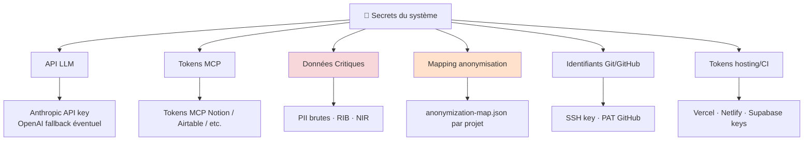
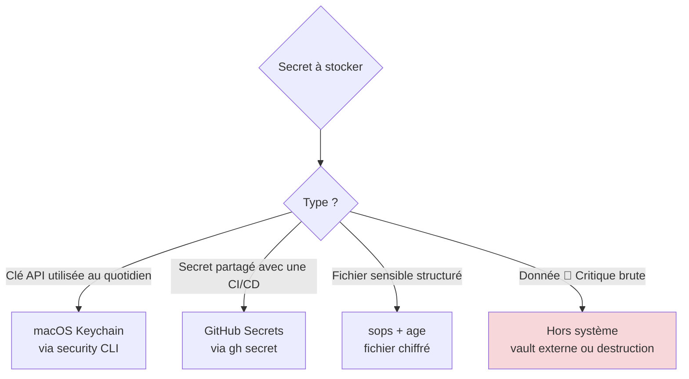
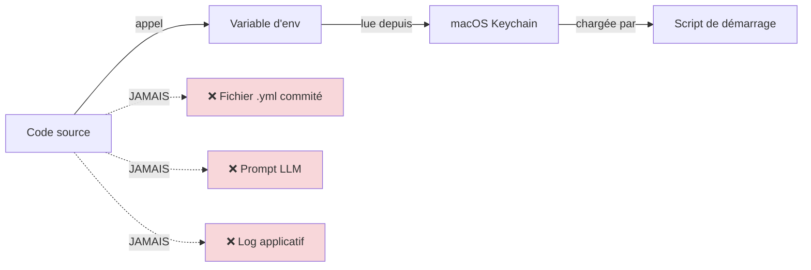
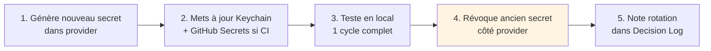

# 🔑 Gestion des secrets

> **Statut** : Sprint 2 sécu : référence active.
> **Couvre** : tout secret (clé API, token, mot de passe, donnée brute classifiée 🔴 Critique, mapping anonymisation).
> **S'applique à** : mode `client` et mode `perso`. **Non négociable même en perso.**

---

## 🎯 Pourquoi ce doc

Un secret en clair dans un commit Git, un log, un prompt LLM ou une config publiée est **irrécupérable** : il faut tout révoquer et rotation. Les conséquences vont de la facture inattendue (clé API exposée) à la fuite de données client (RGPD, contentieux).

**Hypothèse de travail** : **un secret est compromis dès qu'il sort de l'endroit où il devrait être**. La défense est préventive (jamais en clair) plus que curative.

---

## 📋 Inventaire des secrets du système



| Type | Exemples | Stockage | Niveau |
|---|---|---|---|
| **API LLM** | `ANTHROPIC_API_KEY`, `OPENAI_API_KEY` | macOS Keychain | 🔴 Critique |
| **Tokens MCP** | Notion token, Airtable PAT, Granola key | macOS Keychain | 🔴 Critique |
| **Données 🔴 Critiques** | RIB, NIR, PII brute client | Hors système (vault dédié) | 🔴 Critique |
| **Mapping anonymisation** | `.anonymization-map.json` par projet | Local chiffré, jamais committed | 🔴 Critique |
| **Identifiants Git** | SSH key, GitHub PAT | macOS Keychain / `~/.ssh/` | 🔴 Critique |
| **Tokens hosting/CI** | Vercel token, Supabase service key | macOS Keychain + `gh secret` côté CI | 🔴 Critique |

---

## 🏠 Stockage : où vivent les secrets

### Règle absolue
> **Aucun secret ne vit dans un fichier qui peut potentiellement aller sur Git.**

### Hiérarchie de stockage recommandée



### Outils retenus

| Outil | Usage | Pourquoi |
|---|---|---|
| **macOS Keychain** (`security` CLI) | Stockage local des clés API individuelles | Natif, gratuit, chiffré, accessible par CLI |
| **1Password CLI** (`op`) | Alternative si déjà abonné 1Password | Plus ergonomique, sync inter-appareils |
| **`gh secret`** | Secrets côté GitHub Actions (quand on aura de la CI) | Standard, audit trail |
| **`sops` + `age`** | Chiffrer un fichier YAML/JSON entier (ex: `anonymization-map.json`) | Open source, simple, supporte rotation clés |
| **`.env` local** | Chargement runtime depuis Keychain → variables d'env | Standard, jamais commité (présent dans `.gitignore`) |

### Workflow type au quotidien

```bash
# 1. Au premier setup d'un secret (manuel)
security add-generic-password -a "vincent" -s "ANTHROPIC_API_KEY" -w "sk-ant-..."

# 2. Au lancement d'une session de travail (script de démarrage)
export ANTHROPIC_API_KEY=$(security find-generic-password -a "vincent" -s "ANTHROPIC_API_KEY" -w)

# 3. Les agents lisent depuis l'env, jamais depuis un fichier
import os
api_key = os.environ["ANTHROPIC_API_KEY"]  # ← jamais hardcodé
```

> 💡 **Le `.env` peut exister localement** pour fluidifier le dev, mais il n'est jamais source de vérité. Il est régénéré à la volée depuis le Keychain. Présent dans `.gitignore`.

---

## 🚂 Transit : comment les secrets circulent

### Règles

| ✅ Autorisé | ❌ Interdit |
|---|---|
| Variable d'environnement chargée au runtime | Secret en clair dans un fichier de code |
| Lecture depuis Keychain par un script local | Secret en clair dans un fichier de config commité |
| Injection via `gh secret` pour la CI | Secret en clair dans un log applicatif |
| Stockage chiffré (sops/age) pour les mappings | Secret passé en argument CLI visible dans `ps` |
| Référence par nom logique (`{{ANTHROPIC_KEY}}`) | Secret envoyé en prompt LLM |

### Garde-fous techniques



### Le LLM ne voit JAMAIS un secret

C'est la règle la plus importante. Aucun prompt envoyé à Anthropic/OpenAI/Ollama ne doit jamais contenir :
- Une clé API
- Un mot de passe
- Une donnée 🔴 Critique brute

**Conséquences pratiques** :
- Si tu fais coder l'Agent Dev sur une fonction qui utilise une clé API, le code généré référence `os.environ["API_KEY"]`, jamais la valeur réelle
- Si l'Agent Audit Tech doit lire un fichier de config, il lit le *schéma* du fichier, jamais le contenu si celui-ci contient des secrets
- Si un brief client contient des secrets par erreur, le `policies/data-classification.md` impose **extraction manuelle** avant ingestion

---

## 🛡️ Détection : repérer les fuites avant qu'elles ne sortent

### Couche 1 : Pre-commit hook

Avant tout commit Git :

```bash
# .git/hooks/pre-commit
gitleaks detect --no-banner --staged
if [ $? -ne 0 ]; then
    echo "🔴 Secret détecté dans le commit. Annulé."
    exit 1
fi
```

→ Aucun secret ne passe le commit local, même par accident.

### Couche 2 : Sanitisation des outputs d'agents

Cf [`prompt-injection-defense.md`](prompt-injection-defense.md#filtre-2--scan-secrets). Tout output d'agent qui matche un pattern de secret est rejeté avant écriture Canvas.

### Couche 3 : Scan régulier de l'historique Git

Une fois par semaine (cron ou manuel) :

```bash
gitleaks detect --no-banner --log-opts="--all"
```

→ Détecte les secrets éventuellement remontés via merge ou cherry-pick.

### Couche 4 : Alertes GitHub natives

GitHub scanne automatiquement les pushs pour les patterns de secrets connus (Anthropic, OpenAI, AWS, Stripe, etc.) et envoie une alerte si détection. À activer dans les paramètres du repo.

### Outils CLI retenus

| Outil | Usage | Performance |
|---|---|---|
| **`gitleaks`** | Scan secrets dans fichiers + historique Git | Rapide, règles riches |
| **`detect-secrets`** (Yelp) | Alternative Python, baselining pour réduire le bruit | Bon pour ignorer les faux positifs récurrents |
| **`trufflehog`** | Scan profond avec entropie | Plus lent mais détecte les secrets custom |

> Reco : **`gitleaks`** par défaut (pre-commit + scan régulier). Ajout de `trufflehog` mensuel pour les patterns inconnus.

---

## ♻️ Rotation : quand on change les secrets

### Périodicité

| Secret | Rotation recommandée | Déclencheur additionnel |
|---|---|---|
| Clés API LLM (Anthropic, OpenAI) | Tous les 90 jours | Suspicion de fuite, fin de mission client, changement de stack |
| Tokens MCP | Tous les 90 jours | Idem |
| GitHub PAT | Tous les 90 jours | Idem |
| SSH keys | Tous les 12 mois | Vol de machine, changement de poste |
| Tokens hosting (Vercel, Supabase) | Tous les 90 jours | Idem |
| Mapping anonymisation | À la fin du projet | Suppression par défaut après 90j post-livraison |

### Procédure de rotation standard



### En cas de fuite avérée

**Procédure d'urgence** : délai cible : **< 1h** pour révoquer, **< 24h** pour audit complet.

1. **Révoquer immédiatement** le secret côté provider (interface web)
2. **Générer un nouveau secret** et mettre à jour Keychain + CI
3. **Auditer l'historique d'utilisation** du secret compromis (logs provider) : qu'a-t-il fait ? Y a-t-il eu usage anormal ?
4. **Identifier le point de fuite** : où le secret a-t-il fuité ?
5. **Patcher le point de fuite** (config, code, process)
6. **Communiquer si nécessaire** : client / partenaire / autorités (RGPD si données personnelles concernées)
7. **Post-mortem écrit** : ce qui a fuité, comment, ce qui a changé pour éviter récidive

---

## 🧰 Cas particuliers du système Solo Builder

### Cas 1 : Le mapping d'anonymisation

`.anonymization-map.json` par projet contient le mapping `CLIENT_A → Société Réelle SARL` etc. Il permet de désanonymiser les livrables finaux.

**Stockage** :
- Local au repo du projet (jamais commité : `.gitignore` protège)
- Chiffré avec `sops` + `age` pour une protection au repos
- Clé `age` stockée dans Keychain

**Cycle de vie** :
- Créé à l'ingestion du premier brief
- Mis à jour à chaque nouvelle entité anonymisée
- **Supprimé** 90 jours après la livraison finale du projet (sauf demande client explicite documentée)

### Cas 2 : Les MCP

Chaque MCP installé a des permissions et un token. Règles :

| Règle | Concrètement |
|---|---|
| **Allowlist stricte** | Seuls les MCP de cette liste sont autorisés : Notion, Airtable, Granola, Cal.com, Drive, Gmail, Webflow, Bubble, Figma, Webflow, Datagouv, MCP-Registry. Pas d'autres sans audit. |
| **Permissions minimum** | Chaque MCP demande des scopes : on n'autorise que ce qui est strictement nécessaire à son usage |
| **Audit trimestriel** | Revue de la liste des MCP installés + scopes. Désinstaller les non-utilisés. |
| **Rotation tokens** | Idem API keys : 90 jours |

### Cas 3 : Le Canvas YAML lui-même

Le Canvas n'est PAS un secret en soi (c'est juste de la donnée structurée). Mais selon la classification du projet :

| Classification projet | Canvas peut être... |
|---|---|
| 🟢 Public | Commité sur Git public OK |
| 🟡 Interne | Git privé OU public si anonymisé |
| 🟠 Sensible | Git privé chiffré uniquement |
| 🔴 Critique | Le projet ne devrait pas exister sous cette forme |

---

## 🚫 Anti-patterns à ne JAMAIS faire

| ❌ Ne fais pas | ✅ Fais |
|---|---|
| Copier-coller une clé API dans un prompt pour "tester rapidement" | Utiliser une variable d'env, toujours |
| Stocker un secret dans `secrets.yml` versionné, même chiffré | Utiliser Keychain ou sops avec exclusion Git stricte |
| Logguer `os.environ` complet en debug | Logs structurés avec liste blanche de champs autorisés |
| Partager un secret par email/Slack | Partager via 1Password share / gestionnaire dédié |
| Hardcoder un secret "temporairement" puis "je nettoierai" | Toujours référence par variable, jamais de valeur réelle |
| Réutiliser le même secret pour plusieurs services | 1 secret = 1 service = facile à révoquer ciblé |
| Garder une clé après fin de mission client | Rotation systématique à la fin |

---

## 📚 Références externes

- [OWASP Secrets Management Cheat Sheet](https://cheatsheetseries.owasp.org/cheatsheets/Secrets_Management_Cheat_Sheet.html)
- [12-Factor App : III. Config](https://12factor.net/config) : secrets en env vars
- [gitleaks](https://github.com/gitleaks/gitleaks) : scan secrets
- [sops](https://github.com/getsops/sops) + [age](https://github.com/FiloSottile/age) : chiffrement fichiers
- [GitHub Secret scanning](https://docs.github.com/en/code-security/secret-scanning/about-secret-scanning)

---

## 📝 Décisions ouvertes

- [ ] Tester `sops` + `age` sur le `.anonymization-map.json` (sprint 3 ?)
- [ ] Installer le pre-commit hook `gitleaks` sur ce repo dès maintenant
- [ ] Activer le secret scanning GitHub natif sur `VincentG32/solo-builder-ai` (Settings → Code security)
- [ ] Politique de rotation : 90 jours partout ou 60 jours sur certains plus sensibles ?
- [ ] Choix gestionnaire mots de passe principal : Keychain natif suffisant ou 1Password ? À trancher.
